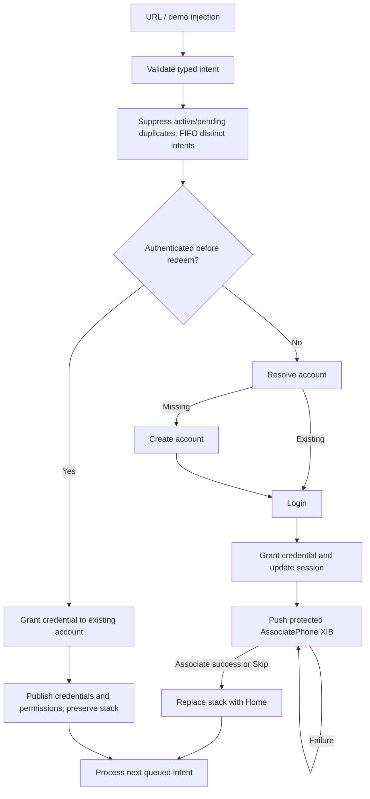

# CoordinatorNavigationDemo

A native iOS 17+ navigation architecture demo using Swift 5 language mode, SwiftUI, UIKit, two real XIBs, async/await, Swift Testing, and XCUITest. No dependencies, project generator, server, or signing team is required to build for Simulator. Developed with Xcode 27.1 / the Swift 6 compiler, with complete concurrency checking.

## Open and run

1. Open `CoordinatorNavigationDemo.xcodeproj` in Xcode (not the supplemental Swift package).
2. Select the shared **CoordinatorNavigationDemo** scheme and an available iPhone Simulator.
3. Press **Run**. The initial state is unauthenticated. All mock data is in memory and resets on process restart.
4. Use the visible demo controls. **Reset / Start unauthenticated** clears accounts, credentials, permissions, failure history, counters, queues and child flows. **Start authenticated** installs a seeded account with one credential and zero login requests.

Choose a signing team only if running on a physical device. The app supports iOS 17+; use Xcode 16+ for Swift Testing (the verified build used Xcode 27.1). The app icon is an opaque 1024px asset included in the project.

## Architecture and ownership

`SceneDelegate` creates `AppComposition`, the sole owner of a single `PolicyNavigationController`. `AppComposition` injects the router and actor-backed repository into `AppCoordinator`. Scene URL contexts and browsing user activities converge on `AppCoordinator.receive`, including cold connection options, foreground delivery and background activation. Cold connection URLs wait for optional authenticated Debug setup; further OS URLs received during startup are buffered until setup completes. Scene disconnect cancels startup delivery. Warm/background UI tests use system URL dispatch and compare an opaque Debug instance identity; launch-by-URL is reserved for explicit cold-start tests. Multiple scene support is disabled.

A regular root container owns the full-window navigation controller and the debug diagnostics overlay as sibling children. Diagnostics never becomes a navigation child or stack entry. The navigation controller's actual `viewControllers` array is the stack source of truth. `NavigationRouter` adds route/policy metadata, serializes transitions, prevents duplicate route pushes, and reconciles metadata in `UINavigationControllerDelegate.didShow`. SwiftUI does not contain a `NavigationStack`; each SwiftUI screen is hosted in a `UIHostingController`. UIKit screens load named XIBs with connected outlets and actions. The diagnostics panel observes real router/session/coordinator state; it does not control stack state.

The domain layer contains Sendable account, session, credential and authentication outcome values, a repository protocol and `RedeemCredentialUseCase`. The use case owns account lookup, create/login selection and redemption orchestration. `MockBackend` implements the protocol as an actor. Coordinators handle UI flow, never networking or account-resolution logic. `SessionStore` is a main-actor observable store: authentication, owned credentials and granted permissions are distinct. Updating credentials publishes new data to visible screens without rebuilding navigation.

- **AppCoordinator** owns global flow, child retention, session transition decisions, intent processing and reset generations.
- **RedeemCoordinator** owns status/retry UI and reports explicit completion actions through closures.
- **OnboardingCoordinator** owns the phone-association task, loading/error state and a single completion callback.
- **HomeCoordinator** owns authenticated navigation and supplies UI action closures to SwiftUI/XIB controllers.
- **NavigationRouting** exposes push, pop, popTo, setRoot, replaceStack, present and dismiss. Coordinator tests use a router spy; router tests exercise the real navigation controller.

Child coordinators are retained by the parent and removed on completion. UI actions and router callbacks capture coordinators weakly. Tasks capture dependencies independently, check cancellation and validate the app generation before applying results. Reset cancels active tasks, awaits redemption termination, resets actor state and rejects obsolete callbacks. URLs arriving during reset are deferred until the new environment is ready. Stopping the coordinator invalidates suspended resets too. Administrative reset otherwise completes atomically even if its caller is cancelled, so it cannot leave the UI busy or the environment half-reset.

## Redeem flow



The use case receives the **session captured before the transaction started**, including across retry. Its result explicitly says whether phone onboarding is required. Newly authenticated users see the stack `welcome → redeem → phone`. The phone screen is genuinely pushed; the redeem hosting controller remains beneath it. Associate and Skip atomically replace the stack with `[home]` and release onboarding. The phone screen cannot return to login/redeem.

An already authenticated user keeps the same session and controller instances. Redemption performs no create/login, never opens phone onboarding, and refreshes observed credential/permission data in place. Navigate to **Secondary SwiftUI screen**, then **Add credential**, to see stack preservation. Diagnostics show zero login requests in a seeded authenticated environment.

Unauthenticated errors stay on the redeem status screen with **Retry** and **Return**. Return ends the failed intent and restores Welcome. Authenticated errors use a global alert over the current screen or modal. Retry preserves the original session; Cancel ends the failed intent and lets the next queued intent proceed. The status row is also updated. Invalid/expired codes do not mutate the session. Phone errors remain on the phone screen with retry and Skip available; submissions are disabled while a request runs. Successful association is followed immediately by Home.

## Intent policy and deep links

`DeepLinkParser` uses `URLComponents` to validate scheme, host/path, one required nonempty access code, permitted code characters and length. Credentials, userinfo, ports, fragments, unknown URL routes and untrusted HTTPS hosts are rejected. Codes use uppercase letters/digits with single hyphen separators (max 64 characters). Unknown well-formed codes produce a recoverable backend error.

Only one intent owns a redeem transaction at a time. Distinct valid intents queue FIFO; duplicates of active/pending intents are suppressed. The active transaction stays active throughout phone association, including retries. On authenticated success, phone completion or explicit error Return, the next intent starts. Its authentication context is captured **then**, so a queued ADD-CRED follows new-user onboarding as an authenticated transaction. A completed link can be delivered again to refresh data: backend redemption is idempotent for `(account, code)` and cannot duplicate a credential. Queue and idempotency history are process-local. Nothing logs URLs, codes, tokens or account identifiers. Diagnostics contain route names, counts, public demo permissions and flow state only.

The demo controls inject via the same URL parser/processor as the OS. For actual Simulator URL delivery:

```sh
xcrun simctl openurl booted \
  'credentialdemo://redeem?code=NEW-USER'
xcrun simctl openurl booted \
  'credentialdemo://redeem?code=EXISTING-USER'
xcrun simctl openurl booted \
  'credentialdemo://redeem?code=ADD-CRED'
```

For cold start, terminate the app then open a registered link:

```sh
xcrun simctl terminate booted com.example.CoordinatorNavigationDemo
xcrun simctl openurl booted 'credentialdemo://redeem?code=NEW-USER'
```

For warm/background delivery, launch the app, optionally background it in Simulator, then run `openurl`. To exercise queueing, send NEW-USER followed immediately by ADD-CRED (or send ADD-CRED while phone onboarding is displayed). Skip/associate the phone, then observe two credentials on Home. Repeat the same active link to exercise suppression.

The entry layer also handles `NSUserActivityTypeBrowsingWeb` for `https://demo.example.com/redeem?code=...`. No real Universal Links are claimed: the placeholder domain has no association entitlement or server. Production needs an owned HTTPS domain, Associated Domains capability with `applinks:<domain>`, a valid `apple-app-site-association` document identifying the team/bundle and allowed paths, and signed-device validation. The custom scheme and demo controls require none of that.

## Reproducible codes

| Code | Required initial state | Behavior |
|---|---|---|
| NEW-USER | Reset / unauthenticated | Create deterministic account, login, grant Welcome Library, push phone |
| EXISTING-USER | Reset / unauthenticated | Lookup existing account, login, grant Member Library, push phone |
| ADD-CRED | Start authenticated, or finish onboarding first | Grant Premium Library with `premium` permission; preserve stack |
| INVALID | Either | Recoverable invalid-code error; no mutation |
| EXPIRED | Either | Recoverable expired-code error; no mutation |
| NETWORK-FAIL | Either | First request fails, next retry succeeds and grants Recovered Library |

NEW-USER, EXISTING-USER and NETWORK-FAIL also work when authenticated: grant to the current account, no login or phone. ADD-CRED while unauthenticated deterministically fails before account lookup/login. Repeating NEW-USER after logging out without resetting logs into the already-created deterministic account. Reset clears that account. Repository identifiers and data do not use random values.

On the phone XIB, enable **Simulate request failure**, tap Associate and observe the recoverable error. Disable the switch and retry, or choose Skip. Ordinary success uses the switch off. A development-only diagnostics overlay is available on every screen; expand it to inspect flow, authentication, actual routes/current screen, coordinator, credential/permission counts, pending intents and Back policy. Home and Welcome also show diagnostics below demo controls.

## Back policy and mixed navigation

Protected redeem/phone routes use `.blocked`. The router hides the bar Back item, disables only the current screen's interactive pop, and rejects ordinary `pop`/`popTo`. `PolicyNavigationController` also blocks direct UIKit pop/popTo/popToRoot calls. The interactive gesture delegate checks current policy and transition state. `didShow` restores normal behavior for unprotected routes, including after interactive cancellation. Explicit coordinator stack replacement is the flow-completion authority and bypasses ordinary Back rules. The protection is not a global gesture disable.

Explore these paths:

- Home → Secondary: SwiftUI → SwiftUI.
- Home → UIKit Lab: SwiftUI → UIKit/XIB.
- UIKit Lab → SwiftUI details: UIKit/XIB → SwiftUI.
- UIKit Lab → UIKit detail: UIKit/XIB → UIKit/XIB (a second instance of the ordinary lab XIB).
- Details → UIKit detail: SwiftUI → UIKit/XIB.

Ordinary Back works throughout authenticated screens. Duplicate routes already in the stack are ignored; use Back to return before pushing the same route again. No view/view model references the navigation controller or unrelated coordinators. Presentation and dismissal are also demonstrated as described below; neither creates a second navigation stack.

## Presented screens

Choose **Start authenticated** (or finish credential onboarding), then use **Present screens** on Home or Secondary:

- **Present SwiftUI sheet** opens a credential summary in a `UIHostingController` with medium/large sheet detents and a grabber. Drag down or tap **Done** to dismiss. The header displays the unchanged underlying navigation stack.
- **Present UIKit full screen** opens the real `NavigationLabViewController.xib` as a full-screen modal. Tap **Dismiss full screen** to return. Its navigation actions first dismiss, then push a SwiftUI detail or UIKit detail onto the original stack. **Present SwiftUI sheet** dismisses the full-screen modal and opens the sheet instead.
- A pushed **UIKit / XIB lab** also has **Present SwiftUI sheet**, demonstrating XIB-to-SwiftUI presentation while keeping the lab on the stack.

`HomeCoordinator` configures presentation style and routes typed UI callbacks to `NavigationRouting.present`/`dismiss`. No view uses SwiftUI `.sheet`, environment dismissal or UIKit navigation APIs. `PresentationRoute` tracks the current modal separately from push routes. Diagnostics show the presented screen as current without inserting it into the stack; the sheet also shows its presentation state. Credentials in the sheet observe the same session store as the underlying screens.

The router serializes presentation/dismissal with pushes, ignores extra presentations while one is visible, reconciles interactive dismissal and cancellation, and dismisses a modal before explicit root/stack replacement. Presentation from a detached controller is rejected without blocking queued work. No additional coordinator, navigation controller or navigation stack is introduced.

Six presentation UI tests cover Done, swipe dismissal followed by a new modal, cancelled sheet swipe followed by dismissal, full-screen XIB dismissal and subsequent push, switching from UIKit modal to SwiftUI sheet, and presenting from the pushed UIKit lab. Four unit tests cover coordinator presentation configuration, the real XIB dismiss action, reset/duplicate policy and detached presentation handling. Runtime execution is subject to the Simulator limitation documented below.

## Global UIKit and SwiftUI alerts

The **Alerts** section on Welcome, Home and Secondary has **Show UIKit alert**, **Show SwiftUI alert**, and a selector for the renderer used by deep-link errors. Both renderers are also available on credential details, the presented credential sheet and the real XIB lab (pushed or full screen). Alerts are requested through coordinator callbacks and `NavigationRouting.showAlert`; screen implementations never search UIApplication windows or present UIKit controllers themselves.

`AppAlertQueue` owns FIFO requests, active ownership, semantic-key deduplication and once-only action callbacks. It starts inactive. SceneDelegate calls `setSceneActive(true)` on `sceneDidBecomeActive` and pauses new presentations on `sceneWillResignActive`. A request received while backgrounded/inactive waits; on activation the router finds the actual topmost visible controller, including a sheet/full-screen modal, and waits for active navigation/presentation transitions. No second navigation controller or window is introduced. iOS may suspend application work while backgrounded; this does not add a background execution entitlement or promise execution while suspended.

UIKit requests render with `UIAlertController`. SwiftUI requests use native `.alert` inside a transparent hosting controller presented above the current content/modal. It owns its presentation subtree; no hosting view is inserted into another `UIHostingController.view`. The SwiftUI binding starts after UIKit presentation completes and a main-queue turn, with a fresh scene/cancellation check. UIKit transition and dismissal completions release the owned presentation before callbacks or queued navigation continue; there is no dismissal polling. Cancellation never dismisses the underlying feature modal. The latest user-run Simulator suite passed all 74 declarations with zero recorded runtime warnings; native test-window focus-engine console diagnostics remain documented in `docs/Verification.md`.

Authenticated redemption failures now show **Unable to Redeem** with **Retry** and **Cancel** from any authenticated destination or existing modal. The protected intent stays active until a choice: Retry reuses its original session context, while Cancel preserves the current stack/session and advances pending intents. Unauthenticated redeem errors retain their existing visible Retry/Return screen. Malformed/unsupported URLs use a generic global alert with no URL/code in the message. Reset/disconnect discard pending alerts and invalidate their callbacks; an existing user modal remains intact when an error alert is acknowledged.

Background example: choose Start authenticated, open a sheet or XIB lab, background the app, then use `xcrun simctl openurl booted 'credentialdemo://redeem?code=NETWORK-FAIL'`. On foreground activation the recoverable error appears above that same destination; Retry succeeds without re-login or removing the modal. Repeat with INVALID and Cancel to preserve the session unchanged. For SwiftUI error rendering, choose SwiftUI in Error alert style before navigating/backgrounding.

## Tests and verification

Run unit and UI tests in Xcode with **Product → Test**, or select an available Simulator:

```sh
cd /path/to/CoordinatorNavigationDemo
xcrun simctl list devices available
# Substitute an available device name or use its id in the destination.
xcodebuild build-for-testing \
  -project CoordinatorNavigationDemo.xcodeproj -scheme CoordinatorNavigationDemo \
  -destination 'generic/platform=iOS Simulator' CODE_SIGNING_ALLOWED=NO
xcodebuild test \
  -project CoordinatorNavigationDemo.xcodeproj -scheme CoordinatorNavigationDemo \
  -destination 'platform=iOS Simulator,name=iPhone 17' \
  -only-testing:CoordinatorNavigationDemoTests CODE_SIGNING_ALLOWED=NO
xcodebuild test \
  -project CoordinatorNavigationDemo.xcodeproj -scheme CoordinatorNavigationDemo \
  -destination 'platform=iOS Simulator,name=iPhone 17' \
  -only-testing:CoordinatorNavigationDemoUITests CODE_SIGNING_ALLOWED=NO
```

`DomainTests` and `IntentProcessorTests` cover parsing/rejection, new/existing/authenticated account rules, idempotency, credential/permission updates, network retry, phone success/failure, FIFO/suppression and reset. `ArchitectureTests` cover cold-start processing, session transitions, phone eligibility, Skip/associate, protected stack replacement, authenticated preservation, cancellation, actual router behavior and XIB outlet loading. The UI suite covers default launch with visible/tappable Welcome controls, redeem through the on-screen injection control, authentication/reset through real UI actions, diagnostics without obscuring navigation, plus workflows A–F: new-user Skip, existing-user Associate, authenticated secondary preservation, invalid code recovery, mixed UI paths and protected swipe/Back plus failure/retry. The composition regression test verifies that diagnostics and navigation are siblings and repeated startup cannot add extra children.

Tests use deterministic backend data, zero delays for unit tests and XCUITest existence waits for UI state. UI tests launch a fresh in-memory environment. `--authenticated` and `--link CODE` are Debug launch helpers; production URL entry points do not depend on them.

A supplemental dependency-free Swift package can run the **same portable domain and intent test files** on macOS:

```sh
swift test
```

This does not replace the iOS coordinator/router/XIB or UI tests. The Xcode project does not depend on SwiftPM. See [docs/Verification.md](docs/Verification.md) for actual execution results and environment limitations.

## Trade-offs and next steps

The demo deliberately keeps one scene and one stack; production multiwindow support would need per-scene composition and an explicit shared-session policy. Persistence, secure credential storage, a real backend and real Universal Link association are omitted. Mock permission unions demonstrate access changes; production authorization must remain server-enforced. Reset and seed controls are for this architecture experiment. Public diagnostic details and launch helpers compile only in Debug; the underlying demo controls remain available to make Release builds reproducible too.

The router uses concrete UIKit controllers at the infrastructure boundary, while the protocol and typed routes keep feature coordination testable. It does not introduce a generic routing framework. A production implementation could add persisted idempotency keys/intent queues, bounded queue policies, analytics with redaction, richer authentication, and a coordinated logout flow. None is necessary to run the requested scenarios.
