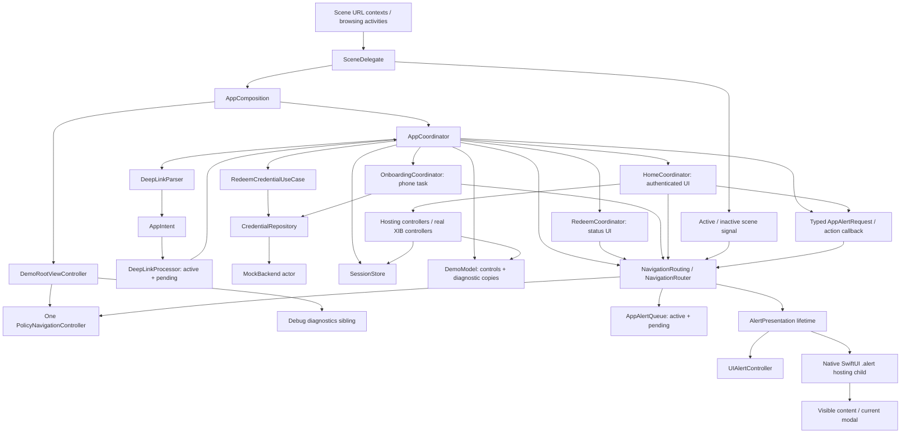

# Architecture audit — alert-aware revision

> **Historical audit snapshot.** References to "current", line numbers, test counts and open findings below describe the audit baseline before subsequent alert/navigation hardening. They are not a current defect list. See the [navigation contract](../NavigationContract.md), [latest verified results](../Verification.md), [task-level implementation status](implementation-status.md) and [strict navigation review](navigation-strict-review-2026-11-07.md). Original evidence below remains unchanged.

Audit date: 2026-11-07, alert-aware revision. Baseline: the current working tree, including the native UIKit/SwiftUI alert extension and earlier local changes, not only published commit `c2209c9c6fcc692947f94a6b62029553a6ae4f0a`.

This is an analysis-only re-audit. Production code, tests, XIBs, configuration and existing non-audit documentation are unchanged. The five earlier reports were read and preserved byte-for-byte under [history/pre-alerts-2026-11-07](history/pre-alerts-2026-11-07/architecture-audit.md). Current reports supersede that snapshot. README, GlobalAlerts, verification history, current alert source, router, scene/app coordinators, UI wiring, XIBs and tests were re-inspected. Source references below use current line numbers. Prior architecture conclusions remain unless explicitly revised.

## Executive assessment

**Keep the architecture; simplify its bookkeeping and improve its evidence.** This is a small application, not an overgrown generic routing framework. Four concrete coordinators have recognizable responsibilities. One real UIKit stack is authoritative; SwiftUI has no competing navigation stack. The use case, actor repository, session store, parser and intent queue each provide a useful boundary. There is no justification for replacing these with a new architecture or removing XIB support.

No P0 crash/security defect was found. **Confirmed P1 reliability findings now include unsupported SwiftUI host containment (F23), a state-publication runtime warning whose exact mutation still needs tracing (F24), and a URL-test launch assumption that invalidates warm/background preservation evidence (F25).** The finalized current native run reports **39 unit declarations passed; 19 UI methods passed and 2 failed**. Both failures wait for the global error alert after a second launch; they are not proof that ordinary warm delivery is broken. The old silent-authenticated-error finding F16 is addressed in source by Retry/Cancel, but its native acceptance remains open. The shutdown queue edge F03 and request-invariant gap F19 remain. SwiftUI dismissal/identity concerns F18 remain conditional risks, distinct from the recorded warnings.

The best simplifications are one child-retention mechanism, no invisible redeem presentation coordinator for authenticated transactions, and a typed diagnostic snapshot instead of individually mirrored fields. Do these incrementally after strengthening the critical tests. Do not collapse meaningful boundaries merely to reduce file count.

## Ten highest-value actions

| Order | Finding | Classification / action |
|---|---|---|
| 1 | F23 | Confirmed unsupported SwiftUI containment; correct and prove warning-free composition |
| 2 | F25 | Confirmed URL-test launch assumption; establish real warm/background delivery before judging preservation |
| 3 | F24 | Confirmed publication warning; trace its mutation after containment correction |
| 4 | F17/F18 | Coverage gap / conditional risk; prove owned alert cleanup and release of queued work |
| 5 | F01 | Coverage gap; exercise the attached real router during transitions/cancellation |
| 6 | F02/F08 | Coverage/DI concern; gate business suspension stages before cancellation assertions |
| 7 | F03 | Source-traced stop edge; invalidate pending obsolete navigation |
| 8 | F07 | Confirmed unbounded retention; choose explicit finite intent/deferred/alert policies |
| 9 | F19 | Confirmed invalid request admission; enforce valid unique alert actions |
| 10 | F04/F05/F06 | Architectural redundancy; simplify child ownership, hidden presentation and diagnostic mirrors after tests |

The first three are runtime/test evidence, not a reason to rewrite coordinators. F20–F22 are policy/documentation or observational improvements. Retain the single stack, meaningful feature boundaries, use case/repository, actor and main-actor ownership.

## Inventory and dependency flow

- Native app target: `CoordinatorNavigationDemo`.
- Unit target: `CoordinatorNavigationDemoTests`, Swift Testing, 39 declarations.
- UI target: `CoordinatorNavigationDemoUITests`, XCTest/XCUITest, 21 methods.
- Shared scheme: `CoordinatorNavigationDemo`; its Test action uses Debug and includes both test targets (`CoordinatorNavigationDemo.xcodeproj/xcshareddata/xcschemes/CoordinatorNavigationDemo.xcscheme:25–52`).
- The current source has 25 Swift files counting `Package.swift`, two real XIBs and additional alert documentation. Published Git tracking still lags local additions; inventory includes the untracked alert source/test files. Counts describe size, not quality.
- Every native target/configuration specifies Swift **5.0**, iOS **17.0**, and complete concurrency checking (`CoordinatorNavigationDemo.xcodeproj/project.pbxproj:407–420,473–486,541–554,566–580,594–608,622–634`). Xcode is 27.1; its Swift compiler version does not change the project's language mode.
- Supplemental Swift package: portable domain/data/deep-link/alert-queue sources and 21 portable unit declarations; Swift tools 6.0, Swift language mode v5, macOS 13 (`Package.swift:1–17`). It is not a dependency of the native project.
- No third-party packages, service locator, type-erased factory graph, `UIViewControllerRepresentable`, SwiftUI `NavigationStack` or `NavigationView` was found.

Composition is explicit: `AppComposition.init` creates the one navigation controller, router, mock actor and app coordinator (`Core/DependencyInjection/AppComposition.swift:12–20`). A regular root controller contains navigation and diagnostics as siblings (`:44–73`), preserving the earlier startup fix. `SceneDelegate` retains composition and the window (`App/AppDelegate.swift:10–24`). No singleton navigation accessor or hidden container lookup is used.

## Coordinator and router responsibilities

| Component | Actual responsibility | Assessment |
|---|---|---|
| AppCoordinator | Session/flow decisions, intent ownership callbacks, redemption task, reset generation, child retention, diagnostics | Keep global orchestration; reduce mixed bookkeeping/admin concerns |
| RedeemCoordinator | Hosting controller, status/error model, retry/Return callbacks | Keep for visible unauthenticated flow; authenticated invisible instance is unnecessary |
| OnboardingCoordinator | Pushed phone XIB, loading/error task, once-only completion, cancellation | Keep: meaningful lifecycle separation |
| HomeCoordinator | Push factories, modal configuration, dismiss-then-navigate closures | Keep: coherent UI responsibility, no unrelated feature references |
| NavigationRouting | UIKit operations plus read-only route/policy/modal state and change callback | Keep as a test boundary; includes operations explicitly required by the demo |
| PolicyNavigationController | Direct UIKit pop enforcement | Keep alongside router/gesture policy; it closes a different entry point |
| NavigationRouter | Navigation queue, modal metadata, scene-gated alert scheduling and owned renderer lifetime | Keep one arbitration point; test cross-queue priority/cancellation and native completion |

`NavigationRouter.routes` derives from `viewControllers`, not a separately mutated route array (`Core/Navigation/NavigationRouter.swift:71`). `metadata` maps controller identities to configuration (`Core/Navigation/NavigationRouter.swift:50,136,149,173–177`); it is not another stack. `PresentationRoute` and a weak presented-controller reference describe a different navigation dimension, not redundant push routes. Route de-duplication is semantic; `ObjectIdentifier` identifies concrete controller instances. Both have a purpose.

Router-level, navigation-controller-level and gesture-level Back checks are intentional defense at separate entrances. Do not remove them as textual duplication. The duplicate `hidesBackButton` assignment in the phone controller is a small presentational redundancy, not evidence the router policy is absent.

## State ownership ledger

A = authoritative state/input; D = derived; C = cache/mirror; L = lifecycle/configuration. Immutable dependency references are owners/links, not duplicate business state.

| Owner / symbol | Classification and source | Recommendation |
|---|---|---|
| `SessionStore.session`, `.credentials` (`Core/Session/SessionStore.swift:4–5`) | A: current client session and owned-credential snapshot, populated from use-case/reset results | Keep; consider one immutable session snapshot only if atomic observation is needed |
| `SessionStore.isAuthenticated`, `.permissions` (`:6–7`) | D: session presence / union of credential grants | Keep derived; do not introduce independent writable permission/auth booleans |
| `AppCoordinator.flow` (`App/AppCoordinator.swift:9`) | A: orchestration phase, not business session or actual current controller | Keep distinction; document transient phase vs pending UIKit transitions |
| `.children` plus `.redeem/.onboarding/.home` (`:8,10–12`) | L: two strong retention mechanisms for the same fixed children | Consolidate ownership, F04 |
| `.originalSession`, `.activeCode` (`App/AppCoordinator.swift:21–22,75–76`) | A: pre-operation transaction context; required across retry | Keep together in a small transaction value if helpful; do not infer from updated session |
| Local `original` and `token` (`App/AppCoordinator.swift:90–92`) | L: immutable task captures of transaction context/generation | Keep; these prevent mutable state from changing under suspended work |
| `.operation`, `.resetTask` (`:16–17`) | L: unstructured task handles for cancellation/join | Keep explicit; clear completed handles for clarity only, not as a supposed leak fix |
| `.generation` (`:18`) | A/L: invalidation token across reset/stop | Keep until staged cancellation tests justify a simpler mechanism |
| `.resetting`, `.deferredURLs` (`:19–20`) | A/L: administrative reset gate and raw deferred events | Bound/validate deferred data, F07 |
| `.started`, `.stopped` (`:23–24`) | L: effectively one-shot lifecycle; `start` after `stop` does not restart | Document terminal-stop semantics; an enum is optional, not required |
| `DeepLinkProcessor.active`, `.pending` (`Core/DeepLinks/DeepLinks.swift:22–23`) | A: active protected intent and FIFO waiting intents | Keep separate ownership; bound capacity deliberately |
| `.pendingCount` (`:24`) | D: queue count | Keep derived |
| Processor `.onIntent/.onChange`, router `.onChange`, nav `.permitsBack` | L: event/policy callbacks; app captures are weak | Keep simple callbacks; no event bus needed |
| UIKit `.viewControllers` | A: push stack | Preserve as sole stack authority |
| Router `.metadata` (`Core/Navigation/NavigationRouter.swift:50`) | C: controller-to-route/policy configuration, pruned using real stack | Keep reconciliation; test interactive cancellation |
| Router `.queue`, `.transitioning` (`Core/Navigation/NavigationRouter.swift:51,54`) | A/L: pending commands and transition gate | Keep; shutdown invalidation gap F03 |
| Router `.presentedRoute`, weak `.presentedController` (`Core/Navigation/NavigationRouter.swift:55–56`) | C/L: active modal metadata | Keep separate from push stack; verify adaptive delegate lifecycle |
| `.originalGestureDelegate` (`Core/Navigation/NavigationRouter.swift:57`) | L: weak forwarder to UIKit gesture behavior | Keep current minimal forwarding; do not globally disable swipe |
| `Screen.controller/route/policy` (`:8–11`) | Immutable controller identity/route and configurable policy | Configuration, not a parallel stack; `policy` could be `let` if never changed |
| `MockBackend.accounts/credentials` (`Data/Mock/MockBackend.swift:6–7`) | A: mock server state; distinct from client snapshot | Keep actor ownership; not redundant with SessionStore |
| `.networkFailureDelivered`, `.counters`, `.delay` (`:5,8–9`) | A/config: deterministic failure history, metrics, delay | Keep for reproducibility; do not use counters as app flow authority |
| `RedeemViewModel.loading/error` (`Features/Redeem/RedeemCoordinator.swift:4,6`) | A: redeem presentation state | Keep; no extra navigation ViewModel needed |
| `.message` (`:5`) | Constant represented as published mutable state | Simplify, F15 |
| `RedeemCoordinator.showScreen`, callbacks, UUID (`:9,12–15`) | L: presentation/lifecycle configuration | Remove invisible coordinator branch when simplifying F05 |
| `PhoneViewModel.loading/error/status` (`Features/Onboarding/OnboardingCoordinator.swift:4–7`) | A: XIB presentation state | Keep; a single render state is optional after tests |
| `OnboardingCoordinator.task/finished/onFinish` (`:15–17`) | L: task and once-only completion gate | Keep cancellation + completion gate; do not replace with loading alone |
| `.session`, repository/router references (`:12–14`) | Immutable dependencies/context | Keep constructor injection |
| `DemoModel.code/status/busy` (`Features/Demo/DemoViews.swift:4–8`) | A: user input, user-facing result status, reset-control gate | Keep separate from diagnostics; `busy` currently means resetting, not redeeming |
| `.flow/authentication/routes/presentedScreen` (`Features/Demo/DemoViews.swift:9–12`) | C: copies from app/session/router | Consolidate as read-only typed diagnostic snapshot, F06 |
| `.credentialCount/permissions/activeCoordinator/pendingCount/backBlocked` (`Features/Demo/DemoViews.swift:13–17`) | C: diagnostic copies of authoritative owners | Same F06; never use to make business/navigation decisions |
| `.loginCount` (`Features/Demo/DemoViews.swift:18`) | C: backend metric read after redeem/reset | Decouple diagnostic await from flow progression, F08 |
| `.inject/.reset` (`Features/Demo/DemoViews.swift:19–20`) | L: demo UI callbacks | Keep weak parent captures; gate for non-demo shipping, F12 |
| `DiagnosticsView.expanded` (`Features/Demo/DemoViews.swift:82`) | A: local expansion UI state | Keep SwiftUI `@State` |
| Phone `observation` and XIB outlets (`Features/Onboarding/AssociatePhoneViewController.swift:5–14`) | L: weak outlets and cancellable subscription; switch holds local failure-simulation input | Keep actual XIB references; review/coalesce render notifications only if measured |
| Lab XIB outlets and action closures (`Features/Home/NavigationLabViewController.swift:4–15`) | L: view links and injected UI requests | Keep; optional close/sheet actions select demo mode |
| `AppComposition.started` and root/controller references (`Core/DependencyInjection/AppComposition.swift:6–10`) | L: idempotent startup and ownership | Keep; root has no competing navigation state |
| `SceneDelegate.window/composition` (`App/AppDelegate.swift:11–12`) | L: scene lifetime owners | Keep; disconnect now stops/releases composition; test its completion semantics |
| `RedeemResult.authentication/needsPhoneAssociation` (`Domain/Models/Models.swift:10–16`) | Transaction outcome and currently redundant eligibility encoding | Keep explicit outcome; computed eligibility is optional if invariant remains fixed |

All View `let` callbacks, observed-object references, and model value fields are immutable dependency/data links. They are not independent mutable state. Diagnostic duplication is a maintainability concern; it is not currently a competing source of navigation authority.

## Alert ownership and lifecycle ledger

| Owner / mutable state | Role and authority | Audit assessment |
|---|---|---|
| `AppAlertRequest.id/key/style/title/message/actions` (`Core/Alerts/AppAlert.swift:22–44`) | Immutable per-request identity, semantic dedupe key, renderer and user action contract | Useful typed boundary; validate actions, F19. Dedupe key must not contain access code/URL |
| `AppAlertQueue.active/pending` (`:79–80`) | Authoritative alert request ownership and FIFO waiting work | Distinct from business intents and navigation operations; not three redundant copies of one queue |
| `sceneIsActive` (`:75`) | Latest scene eligibility signal, initially false | Forwarded by SceneDelegate and router; governs new display, not guaranteed background execution |
| `current/pendingCount` (`:76–77`) | Read-only derived queue summaries | Correctly derived; not currently exposed to diagnostic overlay |
| Entry completion (`:70–72`) | At-most-once user outcome for an accepted request | Duplicate/cancelled requests deliberately receive zero callbacks, F22 |
| `NavigationRouter.alerts/alertPresentation` (`Core/Navigation/NavigationRouter.swift:52–53`) | Queue owner and strong owner of one renderer lifetime | Retain while visible/dismissing; blocks navigation until renderer completion |
| `AlertPresentation.presenter/root` (`Core/Alerts/AlertPresentation.swift:8–9`) | Weak scene-specific presentation links | No UIApplication global window lookup |
| `anchor/nativeAlert/swiftUIState` (`:10–12`) | Owned hosting child, native dismissal target and native SwiftUI binding model | UIKit native target is exact; SwiftUI target is inferred at selection/cancellation, F18 |
| `dismissalTask/finishing/completion` (`:13–15`) | Single dismissal monitor, once-only entry gate, renderer callback | Weak polling Task avoids a demonstrated owner cycle; terminal-state evidence remains incomplete |
| `SwiftUIAlertState.visible` (`:142`) | Native SwiftUI alert binding | Local renderer state, not app flow/authentication |
| `cancelled/started/sceneIsActive/appeared` (`:143–146`) | Lifecycle guards joining anchor appearance and scene activation | Serve different conditions; do not collapse them without tests |
| `DemoModel.alertStyle/showAlert` (`Features/Demo/DemoViews.swift:6–7`) | User-selected error renderer and UI callback | Not alert ownership; no active/pending alert diagnostics exist, F21 |

New alerts wait for an active scene. Existing alerts are not automatically dismissed when the scene resigns. Navigation commands drain before waiting alerts, and every stack replacement currently cancels all alert requests. These are explicit policy choices to review, not cross-queue FIFO guarantees. An authenticated error now keeps its business intent active until Retry/Cancel, unlike the pre-alert version.

## Findings register

Priorities: P0 critical; P1 important reliability work; P2 maintainability/behavior improvement; P3 optional polish. “Confirmed” means source evidence or recorded execution establishes the stated behavior. A testing gap is not proof that the production behavior fails.

### F01 — P1 / Testing, Navigation: transition coverage does not exercise the hard router branches

- **Evidence:** `CoordinatorNavigationDemoTests/ArchitectureTests.swift:118–137,201–253`; `Core/Navigation/NavigationRouter.swift:132–168,181–207`. Real-router tests have no window, making operations nonanimated; presentation flow tests use synchronous `RouterSpy` (`CoordinatorNavigationDemoTests/ArchitectureTests.swift:150–170`).
- **Current behavior/problem:** unit passes do not establish serialization, UIKit delegate completion, adaptive dismissal or interactive cancellation. UI tests are useful but do not deterministically pause transitions. **Classification:** confirmed coverage gap, not confirmed transition failure.
- **Recommendation/benefit:** add attached-window router integration tests and controllable transition boundaries; keep the spy for coordinator decisions. This gives trustworthy protection before changing queue/policy code.
- **Regression risk:** low for test-only work; medium if test seams grow into production abstractions. **Required tests:** queued push/push and duplicate push, dismiss/push, cancelled interactive pop/sheet, replacement during presentation, user Back reconciliation.

### F02 — P1 / Testing, Concurrency: cancellation tests can succeed before the work starts

- **Evidence:** `CoordinatorNavigationDemoTests/DomainTests.swift:68–78`, especially the pre-use-case cancellation check at `:71`; `CoordinatorNavigationDemoTests/ArchitectureTests.swift:105–114`; production suspension points `App/AppCoordinator.swift:95–100,175–183`, `Features/Onboarding/OnboardingCoordinator.swift:31–41`.
- **Current behavior/problem:** immediate cancel/reset does not prove stale-result suppression after account creation/login/redemption or during phone work. **Classification:** confirmed assertion limitation; no stale phone/session mutation reproduced.
- **Recommendation/benefit:** gated repository operations, explicit “entered stage” expectations, then cancel/reset/stop and release. Test cooperative and noncooperative completion separately. Use existing repository protocol before adding any new abstraction.
- **Regression risk:** low for tests; medium for DI changes needed to install a gate. **Required tests:** each awaited stage, deferred URLs during reset, once-only phone completion, weak deallocation after completion/cancellation.

### F03 — P2 / Navigation, Concurrency: stop does not invalidate pending navigation

- **Evidence:** `AppCoordinator.stop()` at `App/AppCoordinator.swift:215–222`; router queue and draining at `Core/Navigation/NavigationRouter.swift:51–60,127–131,185–191`; phone enqueue at `Features/Onboarding/OnboardingCoordinator.swift:22–24`.
- **Current behavior/problem:** with a visible nav and fast backend, an animated redeem push can still be running when phone is queued. Calling `stop()` releases the phone coordinator but leaves the queued push; later `didShow` can show an inert phone screen. Reset normally clears commands through `replaceStack`, so this is a **confirmed lifecycle API edge by source tracing**, not an existing onscreen stop-button failure or recorded Simulator reproduction.
- **Recommendation/benefit:** give terminal shutdown explicit pending-command invalidation, while allowing the already-running transition to reconcile. Define whether stop preserves the current screen or disposes its entire owner.
- **Regression risk:** medium: do not cancel normal onboarding completion/replacement. **Required tests:** hold first push, enqueue phone, stop, finish transition; assert no late phone/controller retention and no obsolete callbacks.

### F04 — P2 / Architecture, Memory: parallel child-retention bookkeeping

- **Evidence:** `App/AppCoordinator.swift:8,10–12,68–71,123–141,147–156,171–172,220–221`; each coordinator's UUID; protocol `Core/Navigation/Coordinator.swift:3–6`.
- **Current behavior/problem:** a dictionary and three typed strong properties describe the same fixed children. Every finish/reset must update both. Current sites are consistent; **no retain cycle or leaked child is confirmed**.
- **Recommendation/benefit:** for this fixed hierarchy, retain through typed properties only and expose a derived child summary if tests/diagnostics need it. Alternatively make the registry sole owner; choose one, not a generic framework. Removes UUID/registry ceremony and duplicated cleanup.
- **Regression risk:** medium: dropping both references before UI completion would break callbacks. **Required tests:** child lifetime through redeem/phone/Home, release once on success/Return/reset/stop, weak references after release.

### F05 — P2 / Architecture, Code Quality: authenticated redemption creates an invisible feature coordinator

- **Evidence:** `AppCoordinator.handle/performRedeem` at `App/AppCoordinator.swift:73–95`; `RedeemCoordinator.start()` at `Features/Redeem/RedeemCoordinator.swift:12–19`; authenticated finish at `App/AppCoordinator.swift:146–152`.
- **Current behavior/problem:** `showScreen == false` makes `start` do nothing, yet the object, model, callbacks, UUID and retention entries are allocated because `performRedeem` requires a redeem coordinator. The app already owns all asynchronous redemption work.
- **Recommendation/benefit:** keep RedeemCoordinator for visible unauthenticated status/retry UI; run an authenticated transaction using its real transaction context with optional presentation updates. Remove the hidden presentation object, not the use case or transaction snapshot.
- **Regression risk:** medium: preserve authenticated errors/queue completion, original authentication across retries and honest active-coordinator diagnostics. **Required tests:** no phone/login/root reset while authenticated; credential updates and all authenticated error paths, F16.

### F06 — P2 / State Management: diagnostic data is mirrored field-by-field

- **Evidence:** `DemoModel` in `Features/Demo/DemoViews.swift:3–20`; `AppCoordinator.refreshDiagnostics()` at `App/AppCoordinator.swift:204–213`, called explicitly from many transitions and router/processor callbacks at `:29–31`.
- **Current behavior/problem:** nine diagnostic mirrors plus a metric (ten fields total) require coordinated refreshes and multiple `@Published` notifications. Editable input/status/reset state shares one observable object with mirrors. This is confirmed duplication; dropped frames and stale business decisions are **not** established.
- **Recommendation/benefit:** one read-only typed diagnostic snapshot, leaving user input/status separate. Derive auth/count/permissions from SessionStore and routes from router when creating the snapshot; make one assignment per refresh. Consider atomic session publication separately if subscribers need it.
- **Regression risk:** low/medium: SwiftUI/XIB observation timing changes. **Required tests:** snapshot after pushes, modal swipe, credential update, queue change/reset, and no stack mutation from diagnostic changes.

### F07 — P2 / Deep Links, Memory, Security: intent/deferred/alert retention is unbounded

- **Evidence:** `DeepLinkProcessor.submit/advance` at `Core/DeepLinks/DeepLinks.swift:22–36`; `AppCoordinator.receive/reset` at `App/AppCoordinator.swift:52–55,193–194`.
- **Current behavior/problem:** distinct syntactically valid intents accumulate while phone or an error holds the active flow. During reset even invalid raw URLs are retained before parsing. The new alert queue is also unbounded (`Core/Alerts/AppAlert.swift:79–94`), with distinct alert requests/callbacks retained until allowed presentation or cancellation. Array duplicate searches and `removeFirst()` add linear work as queues grow. README already names bounded queues as omitted.
- **Recommendation/benefit:** validate before deferral where safe and choose/document a finite queue/overflow policy. Keep FIFO and active/pending duplicate suppression; a bounded small array is enough. This bounds retention and processing latency without adding a queue framework.
- **Regression risk:** medium: overflow is an explicit behavior decision; do not silently drop accepted flows. **Required tests:** repeated/invalid/distinct bursts during redeem, phone, error and reset; capacity, ordering, visible overflow response, no code logging.

### F08 — P2 / Architecture, Testing: app orchestration depends directly on mock administration

- **Evidence:** `App/AppCoordinator.swift:14–15,26–28,99,163–190`; business seam `Domain/Repositories/CredentialRepository.swift:3–8`; composition `Core/DependencyInjection/AppComposition.swift:18`.
- **Current behavior/problem:** constructor injection exists, but AppCoordinator constructs its use case from concrete MockBackend and waits for diagnostic metrics before advancing successful navigation. This limits installing controlled repository behavior in app-level tests and mixes business orchestration with demo reset/seed/metrics. No expensive networking or measured navigation delay is claimed for this actor.
- **Recommendation/benefit:** inject the existing business repository/use case explicitly, with mock administration kept as a separate concrete capability at composition. Start with those existing types; introduce a small admin protocol only if a test needs it. Remove diagnostic metric reads from the critical success path.
- **Regression risk:** medium: seed/reset ordering and metrics expectations must remain deterministic. **Required tests:** staged repository completion, reset/seed baseline, successful navigation independent of a held diagnostic read, no additional login on authenticated grant.

### F09 — P2 / Testing, Deep Links: OS delivery scenarios exist but do not prove warm delivery

- **Evidence:** `App/AppDelegate.swift:22–24,43–55`; `CoordinatorNavigationDemoUITests/NavigationUITests.swift:235–265`; parser fixtures `CoordinatorNavigationDemoTests/DomainTests.swift:6–15` versus validation `Core/DeepLinks/DeepLinks.swift:7–15`.
- **Current behavior/problem:** new UI methods use `app.open` for unsupported, INVALID and NETWORK-FAIL URLs. The finalized activities record a new Launch for those calls; the two authenticated cases return to Home and fail before the alert appears (F25). These are not valid warm/background preservation proofs. A dedicated cold-entry case without a competing Debug reset, and a held response completing while inactive, are still missing. Pure queue/spy tests establish logical buffering, not native scene delivery. Parser boundaries still lack persistent tests for every guard; prior temporary probes found no malformed-code defect.
- **Recommendation/benefit:** retain the scenario intent but correct the delivery harness (AUD-17); add a dedicated cold URL case, a controlled inactive-response runtime test, and boundary fixtures. Do not describe reactivation as proof of execution during iOS suspension.
- **Regression risk:** low for pure cases, medium for Simulator orchestration. **Required tests:** parser boundary/error distinctions, actual cold URL delivery, paused backend response while inactive, one queued presentation on activation; real Universal Links remain conditional on domain setup.

### F10 — P2 / Testing: route equality is weaker than controller preservation/observation

- **Evidence:** `authenticatedStackIsPreservedAndUpdatesObserved` at `CoordinatorNavigationDemoTests/ArchitectureTests.swift:28–39`; stronger identity example in `:203–211`; UI test C at `CoordinatorNavigationDemoUITests/NavigationUITests.swift:283–298`.
- **Current behavior/problem:** equal route names and final credentials could pass even if controllers were recreated; the unit test does not observe a publisher despite its name. Current production code does preserve controllers by omitting navigation commands on authenticated success (`App/AppCoordinator.swift:146–152`).
- **Recommendation/benefit:** assert exact controller identities and the relevant store emission, then verify visible data in one UI representative. Rename assertions/tests if they intentionally cover a narrower contract.
- **Regression risk:** low; avoid asserting irrelevant notification counts. **Required tests:** before/after controller arrays, zero root/push commands during authenticated grant, visible data and unchanged session, existing sheet refresh.

### F11 — P2 / Testing: UI gestures can pass without engaging the intended transition

- **Evidence:** `CoordinatorNavigationDemoUITests/NavigationUITests.swift:27–42,128–158,283–298` (`findAndTap`, protected drag, full dismiss/cancelled sheet drag, repeated swipes); bar Back uses `element(boundBy: 0)`.
- **Current behavior/problem:** a failed-to-engage edge drag also leaves phone visible. A 30-point drag with Done remaining does not prove an interactive dismissal actually started and cancelled. Whole-screen swipe searching is layout-sensitive. These are assertion/portability risks, not proof the gestures fail.
- **Recommendation/benefit:** keep representative UI gestures but complement them with attached-router/delegate checks that establish engagement/cancellation. Target known screen/list elements and specific Back labels; wait for screen readiness, not longer arbitrary timeouts.
- **Regression risk:** low/medium: test instrumentation must not become business code or depend on private UIKit internals. **Required tests:** successful ordinary edge pop after onboarding; engaged/cancelled modal transition; reliable controls on small/large layouts.

### F12 — P2 / Security: demo administration is present in Release

- **Evidence:** `DemoControls` actions are outside `#if DEBUG` at `Features/Demo/DemoViews.swift:38–53`; failure switch is wired at `Features/Onboarding/AssociatePhoneViewController.swift:27,43`; only diagnostics/launch arguments are gated (`Features/Demo/DemoViews.swift:61–75`, `App/AppDelegate.swift:25–42`). README explicitly keeps Release demo controls.
- **Current behavior/problem:** **confirmed intentional demo behavior**, not a real authentication bypass: Start authenticated seeds an in-memory account, with no real service/token. Copying this composition into a shipping product would expose seed/reset/failure controls.
- **Recommendation/benefit:** keep a runnable Demo configuration; make any production composition explicitly exclude demo administration and assert that in a Release/production smoke check. Do not claim local permissions authorize a real backend.
- **Regression risk:** medium if controls are blanket-disabled in the only runnable demo. **Required tests:** demo remains reproducible; non-demo configuration has no seed/reset/failure controls; no codes/tokens/URLs in telemetry.

### F13 — P3 / Navigation, Code Quality: phone XIB has a short-height layout risk

- **Evidence:** `Features/Onboarding/AssociatePhoneViewController.xib:7–9`, fixed 48-point action heights, 20-point stack spacing, top/bottom bounds; landscape supported by `App/Info.plist:51–63`. Lab XIB already uses a scroll view (`Features/Home/NavigationLabViewController.xib:18–112`).
- **Current behavior/problem:** in compact landscape with loading/error content, margins/buttons/spacing leave little room for label intrinsic heights. Compression or clipping is a source-supported risk; no screenshot of a broken phone layout was captured in this audit.
- **Recommendation/benefit:** reuse the lab's content/frame-guide scroll layout, preserving real XIB/actions. **Regression risk:** low/medium: scrolling must not interfere with Back enforcement. **Required tests:** landscape loading/error text and reachable Associate/Skip, iPad/small screen and supported text sizes.

### F14 — P3 / Documentation: historical and current test totals compete

- **Evidence:** `docs/Verification.md:15–19,98,107–121`; `README.md:126` counts six presentation UI tests, while the later identifier regression adds another.
- **Current behavior/problem:** initial “not executed” tables and successive “current total” statements can obscure the original 39-pass/5-fail run, the subsequently verified 45-pass pre-alert run, and the finalized 60-declaration alert run (58 passed / 2 failed). Runtime failures must not be confused with architecture findings.
- **Recommendation/benefit:** one current baseline/status block, followed by clearly labeled dated history and reproducible commands. Keep the history; do not overwrite failures with build success.
- **Regression risk:** low. **Required checks:** totals match 39 unit + 21 UI declarations at the current baseline; 21 portable declarations are not described as complete iOS validation.

### F15 — P3 / Code Quality: constant presentation text is published mutable state

- **Evidence:** `RedeemViewModel.message` at `Features/Redeem/RedeemCoordinator.swift:5`, read by `RedeemView` at `:33`; repository-wide writes found only its initializer.
- **Current behavior/problem:** constant progress copy is presented as mutable observable state. This is small unnecessary state, not a functional defect.
- **Recommendation/benefit:** make it immutable or localize the constant in the view. Avoid a generalized render-state redesign for this alone. **Regression risk:** low. **Required checks:** loading/error/retry UI still appears; compile all targets.

### F16 — Addressed in source / State Management, Navigation: authenticated error surface

- **Previous finding:** authenticated details/XIB/modal errors had only a hidden `demo.status` update. That is no longer the current implementation.
- **Current evidence:** `App/AppCoordinator.swift:104–115` requests a global `redeemFailure`; `Core/Navigation/NavigationRouter.swift:91–124` schedules it over the current visible presenter; `Core/Alerts/AlertPresentation.swift:23–51` supplies either native renderer. Retry calls `performRedeem` with the retained original session; Cancel calls `finishAuthenticatedRedeem`, advancing pending intents. No new root or phone is introduced.
- **Status:** error-request implementation exists; it is not a currently missing feature. Three native spy-flow tests (`CoordinatorNavigationDemoTests/ArchitectureTests.swift:258–305`) passed. Of five alert UI methods (`CoordinatorNavigationDemoUITests/NavigationUITests.swift:206–265`), three passed and the authenticated Cancel/background Retry cases failed at helper line 202. Their second-launch behavior is analyzed in F25. Passing renderer cases also emitted F23/F24 warnings; complete native acceptance is not established.
- **Remaining acceptance/risk:** verify all error families on supported destinations/modal states, retained credential/permission/controller snapshots, queued distinct intents after Cancel, repeated failure after Retry and reset/stop during a rendered alert. Link to F17/F18 rather than build another error framework. Regression risk is medium at lifecycle/queue boundaries.

### F17 — P1 / Testing, Navigation: native alert ownership and cleanup lack targeted integration evidence

- **Evidence:** `Core/Alerts/AlertPresentation.swift:55–116`; `Core/Navigation/NavigationRouter.swift:118–130`; `CoordinatorNavigationDemoTests/ArchitectureTests.swift:258–305` uses RouterSpy. New UI tests at `CoordinatorNavigationDemoUITests/NavigationUITests.swift:206–265` request both styles but do not inspect anchor child cleanup or actual queued navigation release.
- **Current behavior/problem:** pure queue tests pass, but cannot validate SwiftUI native anchoring, native controller removal, reset mid-presentation/dismissal, renderer deallocation or alert-to-navigation ordering. **Confirmed coverage gap**, not evidence of a leak/crash/hang.
- **Recommendation/benefit:** attached-window tests for both real renderers, plus representative native UI runs. Track original child/controller identities and verify cleanup after repeated presentation. Retain the finalized 60-declaration result: all unit tests and three new alert UI cases passed, but two URL cases failed and native warnings remain. Add lifecycle evidence beyond basic presentation.
- **Regression risk:** low for tests; medium for any test seam affecting UIKit lifetime. **Required tests:** alert→alert, alert→push, cancel before anchor appearance, reset during native presentation/dismissal, scene detach/reconnect, no extra hosting child or stale business callback.

### F18 — P2 risk / Navigation, Concurrency: SwiftUI native identity and dismissal are inferred

- **Evidence:** `AlertPresentation.captureNativeAlert` at `Core/Alerts/AlertPresentation.swift:85–88` accepts whichever visible controller differs from presenter/anchor. `finishIfDismissed` at `:103–106` completes on a missing window; monitor `:91–100` polls without a terminal failure bound. Router blocks navigation while the renderer exists (`Core/Navigation/NavigationRouter.swift:128–130`).
- **Current behavior/problem:** the UIKit branch retains its exact UIAlertController; the SwiftUI branch has no demonstrated ownership check for the discovered native controller. If it captured unrelated attached content, polling could block navigation indefinitely; if nothing is captured, completion proceeds without proof the expected alert attached/dismissed. Window absence also occurs before attachment or after hierarchy detachment. **Conditional risk only:** router serialization reduces interference, and no supported-path miscapture or stuck monitor has been reproduced.
- **Recommendation/benefit:** establish owned attachment/dismissal lifecycle and explicit cancelled/dismissed/not-presented outcomes before simplifying. Prefer a narrowly tested lifecycle adapter to hierarchy guesses; do not blindly proceed after an arbitrary timeout or replace this with a fixed sleep. Keep both renderers if that demo requirement remains.
- **Regression risk:** medium/high because dismissing the wrong object or proceeding too early can disrupt a valid modal. **Required tests:** exact discovered controller relationship, cancellation before attachment, normal acknowledgment, failed presentation/detached owner, reset/scene detachment, repeated anchor cleanup and next-operation ordering.

### F19 — P2 / Code Quality, Testing: request action invariants are not enforced

- **Evidence:** `AppAlertRequest.init` at `Core/Alerts/AppAlert.swift:31–44` accepts any action array; queue activation/completion `:91–103`; renderers iterate it at `Core/Alerts/AlertPresentation.swift:28–32,163–166`.
- **Current behavior/problem:** a temporary Swift-5 probe using the actual queue confirmed that empty actions are accepted and an attempted OK completion leaves the active request owned; duplicate Cancel actions are also admitted. Repeated enum values are duplicate SwiftUI ForEach identities and can violate native action constraints. **Confirmed admission/invariant gap; no crash in existing valid factories is claimed.** All current demo/redeem factories provide valid lists.
- **Recommendation/benefit:** make invalid action configurations unrepresentable or reject them before activation, with an explicit error contract. Require at least one unique supported action and no repeated Cancel. Do not silently leave an uncompletable active request.
- **Regression risk:** low/medium at construction call sites. **Required tests:** empty/duplicate arrays, duplicate Cancel, accepted valid combinations, no stuck queue after rejection, parity of both renderer action lists. Probe evidence: `/private/tmp/coordinator-alert-reaudit-request-probe.log`.

### F20 — P3 policy concern / Architecture, Navigation: every root replacement cancels all alerts

- **Evidence:** `Core/Navigation/NavigationRouter.swift:81–86,100–102`; phone completion installs Home at `App/AppCoordinator.swift:127–143`; new unsupported-link requests at `:52–59`.
- **Current behavior/problem:** reset/disconnect cancellation is intentional, but ordinary feature completion also cancels unrelated pending/visible alerts. Example: start phone association, receive a malformed link, then association succeeds; Home installation cancels Unsupported Link without acknowledgment. Buffered inactive alerts are discarded too. This policy is already documented; it is **not an undisclosed crash**. It becomes a correctness gap only if those global notifications must survive unrelated feature completion.
- **Recommendation/benefit:** explicitly distinguish global/flow-scoped alert lifetime and reset/stop from normal root change. Keep current behavior if desired, but specify it and test it. Navigation also has priority over waiting alerts (`Core/Navigation/NavigationRouter.swift:128–131`); do not call the combined scheduling cross-queue FIFO. Ordinary finite demo flows do not establish starvation.
- **Regression risk:** medium: preserving an obsolete error could resurrect stale actions; indiscriminate cancellation could lose needed feedback. **Required tests:** visible/buffered global request during association completion, reset/stop cancellation, flow-scoped stale callback suppression, deterministic navigation/alert priority.

### F21 — P3 / State Management, Documentation: alerts are absent from diagnostics

- **Evidence:** enqueue/start/complete/cancel paths `Core/Navigation/NavigationRouter.swift:91–125` do not notify `onChange`; `AppAlertQueue` is not observable (`Core/Alerts/AppAlert.swift:69–80`). `AppCoordinator.refreshDiagnostics` (`App/AppCoordinator.swift:204–213`) and `DemoModel` (`Features/Demo/DemoViews.swift:3–20`) contain no active/pending alert state.
- **Current behavior/problem:** the diagnostic “Current” label describes the underlying feature/modal, even while an alert owns presentation or waits inactive. This is **confirmed observational scope**, not a second navigation source of truth or a business failure.
- **Recommendation/benefit:** label it “current feature” or include a small read-only alert summary (style/phase/count/scene eligibility), without titles/messages/codes. Fold it into F06's typed snapshot rather than adding independently writable published mirrors.
- **Regression risk:** low; accidental secret exposure is the main concern. **Required tests:** enqueue, activate, cancel, completion and lifecycle updates notify once with safe summaries; diagnostics never drive routing.

### F22 — P3 / Documentation, Architecture: callback semantics are at-most-once, not guaranteed once

- **Evidence:** duplicate rejection at `Core/Alerts/AppAlert.swift:86–87` and cancelAll at `:106–108`; explicit tests `CoordinatorNavigationDemoTests/AppAlertQueueTests.swift:48–66,107–133` expect zero duplicate/cancelled callbacks.
- **Current behavior/problem:** accepted user-completed requests get at most one callback; suppressed duplicates/cancelled requests get zero. Matching keys can coalesce different messages/styles. “Once-only action callbacks” must not imply every submitter receives an outcome. Current call sites use safe semantic keys and one redeem transaction, so no current business deadlock from key collision is established.
- **Recommendation/benefit:** document accepted/coalesced/cancelled semantics, optionally return acceptance status if a caller truly needs it. Avoid promises that critical requests can never be dropped when dedupe/cancel policies deliberately coalesce/drop them.
- **Regression risk:** low for documentation; medium if fan-out callbacks are later introduced. **Required tests:** retain existing zero-callback expectations and reentrant completion tests; add explicit acceptance contract only if needed.

### F23 — P1 confirmed defect / Navigation: SwiftUI alert host uses unsupported containment on hosting screens

- **Evidence:** `AlertPresentation.present()` at `Core/Alerts/AlertPresentation.swift:35–51`, especially `presenter.view.addSubview(host.view)` at line 43. The finalized 11:39 xcresult records an unsupported `_UIHostingView<SwiftUIAlertAnchor>` subview warning in `testBothNativeAlertStylesFromSwiftUIAndXIB` and `testAlertsAboveSheetAndFullScreenPreserveThem` (`CoordinatorNavigationDemoUITests/NavigationUITests.swift:206–234`).
- **Current behavior/problem:** visible-controller discovery can select a UIHostingController; the bridge then inserts another hosting view directly into its managed view. UIKit/SwiftUI explicitly warns that this arrangement is unsupported and can break the hierarchy. Both tests pass, so no crash or failed button is asserted from this warning alone. The implementation is nevertheless using a runtime-rejected composition on a required path.
- **Recommended change/benefit:** preserve the typed request queue and router ownership, but anchor native SwiftUI alerts using supported ownership: an alert modifier in owned SwiftUI content, or a regular UIKit container/common ancestor with correct child containment. Preserve XIB alert support. Select the smallest option after an attached-window reproduction; do not blanket-add wrappers to every screen or introduce another window/stack.
- **Regression risk:** medium/high: an alert must remain above the actual sheet/full-screen content and survive presentation transitions without removing that content. **Required tests:** both native styles on SwiftUI/XIB push screens and modals; zero unsupported-containment warnings; same underlying controller identities; anchor removed after acknowledgment/reset. **Plan:** AUD-14.

### F24 — P1 confirmed runtime warning / State Management, Concurrency: alert interactions publish during view updates

- **Evidence:** finalized 11:39 xcresult records `Publishing changes from within view updates is not allowed, this will cause undefined behavior.` in the same two passing alert UI methods at `CoordinatorNavigationDemoUITests/NavigationUITests.swift:206–234`. Candidate mutation sites are `SwiftUIAlertState.visible` and `didAppear/showIfReady` at `Core/Alerts/AlertPresentation.swift:142,150–154`, called by the anchor's `onAppear` at line 162, and cancellation's visible assignment at line 73.
- **Current behavior/problem:** the warning is confirmed, but the result provides no mutation backtrace. The listed state path is a candidate, **not a proven root cause**; containment F23 may contribute. Main-actor isolation does not itself make mutation during a SwiftUI update valid. No actual corrupted state or crash was recorded.
- **Recommended change/benefit:** reproduce with runtime-warning diagnostics/backtrace, correct F23, then trace any remaining publication warning. Move only the proven mutation into a valid lifecycle boundary and preserve scene eligibility/cancel guards; do not sprinkle dispatches or fixed sleeps across models.
- **Regression risk:** medium: deferred publication can race cancellation, scene resignation or anchor removal. **Required tests:** warning-free normal show/acknowledge, inactive appearance, immediate cancellation and repeated alerts; one completion/cleanup per request. **Plan:** AUD-14, separate verified correction if needed after containment.

### F25 — P1 confirmed testing defect / Testing, Deep Links: launch-by-URL is mistaken for delivery to the existing instance

- **Evidence:** `CoordinatorNavigationDemoUITests/NavigationUITests.swift:235–265` uses `app.open`, at lines 250 and 261 for the two failures. The 11:39 activity trees show a second **Launch** nested under each URL Open; failure hierarchies show **Home**, not the previously visible details/full-screen screen. Both fail waiting for `Unable to Redeem` at helper line 202, before Cancel/Retry or preservation assertions. SDK `XCUIApplication.h:46–63` documents URL opening as a launch operation; [Apple's API reference](https://developer.apple.com/documentation/xcuiautomation/xcuiapplication/open(_:)) likewise categorizes it as launching by URL, not guaranteed delivery to a preserved process.
- **Current behavior/problem:** two failing methods assert warm/background preservation after a launch operation. The passing protected-phone test can also recreate its phone from `--link`, so it does not prove original-controller preservation. Source adds a second hazard: connection URLs are dispatched at `App/AppDelegate.swift:22–24` **before** the `--authenticated` Debug reset at lines 27–32, which cancels/clears early work (`App/AppCoordinator.swift:165–175`). That ordering is consistent with the observed Home/error loss; its exact causal timing has not been replayed under instrumentation. This does not establish that normal warm `openURLContexts` is broken.
- **Recommended change/benefit:** separate cold URL launch from warm/background OS delivery. For the latter, use a system URL-open path (for example `XCUIDevice.shared.system.open`, checking supported test SDK/OS), assert process/scene continuity with a safe test marker, and retain original controller identities in lower-level tests. For cold tests, define Debug seed-before-URL ordering so reset cannot erase the delivered intent. Correct tests before changing redeem/error policy or increasing timeouts. A public system API is preferable to test-only navigation branches.
- **Regression risk:** medium: changing launch setup may mask real cold-start bugs; delivery through external UI can be flaky if not synchronized. **Required tests:** true warm details→error→Cancel; background existing modal→URL→Retry; inactive response→one alert on activation; cold URL without seed and with authenticated seed; no second reset/launch in preservation cases. **Plan:** AUD-17, then AUD-04/AUD-14.

## Security, performance and memory conclusions

Application-source search found no `print`, `NSLog`, `Logger`, analytics, token storage, UserDefaults or disk persistence of credentials/access URLs. URLComponents validation rejects unsupported scheme/host/path, userinfo/port/fragment and malformed codes; unknown valid-looking codes fail in the backend. Test-runner parameter output can include public hard-coded demo fixtures; no live secret fixtures should be introduced into parameterized CI output.

`UserSession` is only a mock account ID (`Domain/Models/Models.swift:9`). `MockBackend.redeem` checks mock account existence (`Data/Mock/MockBackend.swift:55`), not a real authentication proof. That is a documented demo boundary; it would be unsafe as a production authorization service. Real permission enforcement must remain server-side. No real account authorization vulnerability was demonstrated here.

Weak UI/parent callbacks, cancellation handles and generation checks are present. No retain cycle is confirmed. Metadata's strong controller reference is pruned after stack reconciliation; it is not automatically a leak. Retaining a completed Task is not proof it retains all completed captures. Add weak-reference tests before claiming lifecycle fixes improve memory. Reset cancels but does not join the phone task: current actor commits are cancellation-aware and contain no suspension, so a stale phone mutation was not established. A noncooperative future repository needs a documented cancellation/server-effect contract.

Repeated published mirrors and render Tasks are candidates for less notification work; no frame-time, CPU or memory measurements establish a performance regression. Normal use has a short stack and few intents. The unbounded queue is the concrete retention risk; do not add a specialized queue package or caching layer without need. Creating one hosting controller per genuinely new screen is the required integration, not excess wrapping.

## Verification performed during this re-audit

| Check | Current evidence |
|---|---|
| Fresh Debug Simulator build-for-testing | **Passed**, application and both native test targets |
| Fresh portable Swift Testing | **Passed: 21 declarations in 4 suites**, including 7 queue tests |
| Temporary request-invariant probe against actual Swift-5 queue | Empty/duplicate arrays admitted; empty current request remains owned after an unsupported OK completion; no UIKit crash probe performed |
| Current native source inventory | **39 unit + 21 UI = 60 declarations**; parameter expansion adds 8 executions |
| Completed user run at 11:09 | **45 passed, 0 failed** (53 expanded cases), pre-alert suite on iPhone 17 / iOS 27.0 |
| Old user run at 10:01 | 39 passed / 5 failed, 44 declarations; retained as history; five sheet identifier failures subsequently addressed |
| Current 60-test native execution from this process | Attempted; CoreSimulator destination discovery blocked before execution |
| Finalized user bundle at 11:39 | **58 passed / 2 failed** of 60 declarations (66 passed / 2 failed expanded), iPhone 17 / iOS 27.0; all 39 unit declarations passed, UI 19/21 |
| Native alert execution | Three alert UI methods passed; two URL methods failed at helper line 202; unsupported hosting and publication warnings recorded. Cleanup/ownership and profiling remain unverified |

The finalized 11:39 bundle supersedes the earlier incomplete observation: it executes all current declarations, including the ten new unit and five new UI cases. The 45-test run remains pre-alert history. Native warning/test details are in [test-coverage-matrix.md](test-coverage-matrix.md); the audit process's separate destination-discovery failure does not erase the completed user-owned result. The compiler macro workaround `-disable-sandbox` was supplied on verification commands only, not persisted. Current logs: `/private/tmp/coordinator-alert-reaudit-build.log`, `coordinator-alert-reaudit-portable.log`, `coordinator-alert-reaudit-native.log`, `coordinator-alert-reaudit-request-probe.log`. [test-coverage-matrix.md](test-coverage-matrix.md) distinguishes logical buffering, spy flow and real UIKit/scene evidence.

## Simplest architecture that should remain

Keep SceneDelegate → explicit composition → AppCoordinator → the three feature coordinators, using one router and one UIKit stack. Keep SessionStore, the redeem use case, existing repository protocol/actor, and typed parser/intent queue. Simplify fixed child retention, avoid the hidden presentation coordinator, centralize diagnostics as one derived value, and inject the business seam sufficiently for gated tests. Verify the implemented F16 alert contract and resolve F03 with narrow lifecycle semantics; do not replace the design with generic routes, a global store, a service locator, or a new reactive framework.

Keep the new pure request queue and a single router-owned presentation lifetime. Do not merge the business-intent, navigation-operation and alert-request queues merely because all use arrays; their ownership and completion rules differ. Correct the unsupported SwiftUI containment, trace the publication warning and repair warm/background test delivery before simplifying renderer lifetime. Harden request invariants without introducing a generic presentation framework. No fixes were made by this re-audit.

Implementation is proposed, not performed. See [redundancy-analysis.md](redundancy-analysis.md), [navigation-flow-audit.md](navigation-flow-audit.md), [improvement-plan.md](improvement-plan.md) and [test-coverage-matrix.md](test-coverage-matrix.md).
