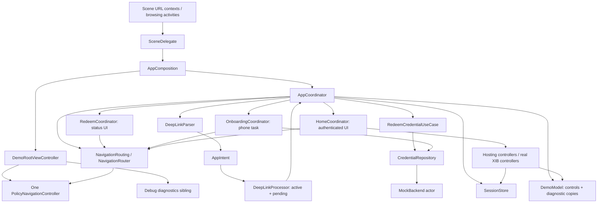

# Architecture audit

Audit date: 2026-11-07. Repository: `CoordinatorNavigationDemo`. Baseline: commit `c2209c9c6fcc692947f94a6b62029553a6ae4f0a` **plus the local changes already present when this audit began**. In particular, the sheet accessibility fix is included. Source line references below describe that working tree, not necessarily the published commit.

This is an analysis-only audit. No production code, tests, project settings, existing documentation, deployment targets or public interfaces were changed. The new reports live only in `docs/audits/`. No earlier audit documents existed. No repository/ancestor `AGENTS.md` or contribution guide was found. README, implementation plan, verification history, all authored Swift files, both XIBs, project/scheme/configuration and tests were inspected. Generated build caches and personal Xcode state are not application source.

## Executive assessment

**Keep the architecture; simplify its bookkeeping and improve its evidence.** This is a small application, not an overgrown generic routing framework. Four concrete coordinators have recognizable responsibilities. One real UIKit stack is authoritative; SwiftUI has no competing navigation stack. The use case, actor repository, session store, parser and intent queue each provide a useful boundary. There is no justification for replacing these with a new architecture or removing XIB support.

No P0 defect or confirmed P1 production crash/security defect was found. Two P1 testing concerns deserve early attention because transition and cancellation behavior carry much of the application's risk. Two concrete P2 behavior defects were identified by source tracing: queued commands can survive `AppCoordinator.stop()`, and authenticated redemption errors have no visible surface on several supported screens. Their scope and reproduction conditions are described below; neither is presented as a newly executed Simulator reproduction.

The best simplifications are one child-retention mechanism, no invisible redeem presentation coordinator for authenticated transactions, and a typed diagnostic snapshot instead of individually mirrored fields. Do these incrementally after strengthening the critical tests. Do not collapse meaningful boundaries merely to reduce file count.

## Inventory and dependency flow

- Native app target: `CoordinatorNavigationDemo`.
- Unit target: `CoordinatorNavigationDemoTests`, Swift Testing, 29 declarations.
- UI target: `CoordinatorNavigationDemoUITests`, XCTest/XCUITest, 16 methods.
- Shared scheme: `CoordinatorNavigationDemo`; its Test action uses Debug and includes both test targets (`CoordinatorNavigationDemo.xcodeproj/xcshareddata/xcschemes/CoordinatorNavigationDemo.xcscheme:25–52`).
- 34 tracked files at baseline, including 22 Swift files counting `Package.swift`, two XIBs and 1,825 tracked Swift lines. These counts describe size, not quality.
- Every native target/configuration specifies Swift **5.0**, iOS **17.0**, and complete concurrency checking (`CoordinatorNavigationDemo.xcodeproj/project.pbxproj:395–408,461–474,529–542,554–568,582–596,610–622`). Xcode is 27.1; its Swift compiler version does not change the project's language mode.
- Supplemental Swift package: portable domain/data/deep-link sources and 14 existing unit declarations; Swift tools 6.0, Swift language mode v5, macOS 13 (`Package.swift:1–17`). It is not a dependency of the native project.
- No third-party packages, service locator, type-erased factory graph, `UIViewControllerRepresentable`, SwiftUI `NavigationStack` or `NavigationView` was found.

Composition is explicit: `AppComposition.init` creates the one navigation controller, router, mock actor and app coordinator (`Core/DependencyInjection/AppComposition.swift:12–20`). A regular root controller contains navigation and diagnostics as siblings (`:44–73`), preserving the earlier startup fix. `SceneDelegate` retains composition and the window (`App/AppDelegate.swift:10–24`). No singleton navigation accessor or hidden container lookup is used.

## Coordinator and router responsibilities

| Component | Actual responsibility | Assessment |
|---|---|---|
| AppCoordinator | Session/flow decisions, intent ownership callbacks, redemption task, reset generation, child retention, diagnostics | Keep global orchestration; reduce mixed bookkeeping/admin concerns |
| RedeemCoordinator | Hosting controller, status/error model, retry/Return callbacks | Keep for visible unauthenticated flow; authenticated invisible instance is unnecessary |
| OnboardingCoordinator | Pushed phone XIB, loading/error task, once-only completion, cancellation | Keep: meaningful lifecycle separation |
| HomeCoordinator | Push factories, modal configuration, dismiss-then-navigate closures | Keep: coherent UI responsibility, no unrelated feature references |
| NavigationRouting | UIKit operations plus read-only route/policy/modal state and change callback | Keep as a test boundary; includes operations explicitly required by the demo |
| PolicyNavigationController | Direct UIKit pop enforcement | Keep alongside router/gesture policy; it closes a different entry point |
| NavigationRouter | Transition queue, per-controller route/policy metadata, delegate reconciliation, modal state | Keep actual stack derivation; test queued/interactive paths before simplifying |

`NavigationRouter.routes` derives from `viewControllers`, not a separately mutated route array (`Core/Navigation/NavigationRouter.swift:66`). `metadata` maps controller identities to configuration (`:47,93,106,130–135`); it is not another stack. `PresentationRoute` and a weak presented-controller reference describe a different navigation dimension, not redundant push routes. Route de-duplication is semantic; `ObjectIdentifier` identifies concrete controller instances. Both have a purpose.

Router-level, navigation-controller-level and gesture-level Back checks are intentional defense at separate entrances. Do not remove them as textual duplication. The duplicate `hidesBackButton` assignment in the phone controller is a small presentational redundancy, not evidence the router policy is absent.

## State ownership ledger

A = authoritative state/input; D = derived; C = cache/mirror; L = lifecycle/configuration. Immutable dependency references are owners/links, not duplicate business state.

| Owner / symbol | Classification and source | Recommendation |
|---|---|---|
| `SessionStore.session`, `.credentials` (`Core/Session/SessionStore.swift:4–5`) | A: current client session and owned-credential snapshot, populated from use-case/reset results | Keep; consider one immutable session snapshot only if atomic observation is needed |
| `SessionStore.isAuthenticated`, `.permissions` (`:6–7`) | D: session presence / union of credential grants | Keep derived; do not introduce independent writable permission/auth booleans |
| `AppCoordinator.flow` (`App/AppCoordinator.swift:9`) | A: orchestration phase, not business session or actual current controller | Keep distinction; document transient phase vs pending UIKit transitions |
| `.children` plus `.redeem/.onboarding/.home` (`:8,10–12`) | L: two strong retention mechanisms for the same fixed children | Consolidate ownership, F04 |
| `.originalSession`, `.activeCode` (`:21–22,68–69`) | A: pre-operation transaction context; required across retry | Keep together in a small transaction value if helpful; do not infer from updated session |
| Local `original` and `token` (`:83–85`) | L: immutable task captures of transaction context/generation | Keep; these prevent mutable state from changing under suspended work |
| `.operation`, `.resetTask` (`:16–17`) | L: unstructured task handles for cancellation/join | Keep explicit; clear completed handles for clarity only, not as a supposed leak fix |
| `.generation` (`:18`) | A/L: invalidation token across reset/stop | Keep until staged cancellation tests justify a simpler mechanism |
| `.resetting`, `.deferredURLs` (`:19–20`) | A/L: administrative reset gate and raw deferred events | Bound/validate deferred data, F07 |
| `.started`, `.stopped` (`:23–24`) | L: effectively one-shot lifecycle; `start` after `stop` does not restart | Document terminal-stop semantics; an enum is optional, not required |
| `DeepLinkProcessor.active`, `.pending` (`Core/DeepLinks/DeepLinks.swift:22–23`) | A: active protected intent and FIFO waiting intents | Keep separate ownership; bound capacity deliberately |
| `.pendingCount` (`:24`) | D: queue count | Keep derived |
| Processor `.onIntent/.onChange`, router `.onChange`, nav `.permitsBack` | L: event/policy callbacks; app captures are weak | Keep simple callbacks; no event bus needed |
| UIKit `.viewControllers` | A: push stack | Preserve as sole stack authority |
| Router `.metadata` (`Core/Navigation/NavigationRouter.swift:47`) | C: controller-to-route/policy configuration, pruned using real stack | Keep reconciliation; test interactive cancellation |
| Router `.queue`, `.transitioning` (`:48–49`) | A/L: pending commands and transition gate | Keep; shutdown invalidation gap F03 |
| Router `.presentedRoute`, weak `.presentedController` (`:50–51`) | C/L: active modal metadata | Keep separate from push stack; verify adaptive delegate lifecycle |
| `.originalGestureDelegate` (`:52`) | L: weak forwarder to UIKit gesture behavior | Keep current minimal forwarding; do not globally disable swipe |
| `Screen.controller/route/policy` (`:8–11`) | Immutable controller identity/route and configurable policy | Configuration, not a parallel stack; `policy` could be `let` if never changed |
| `MockBackend.accounts/credentials` (`Data/Mock/MockBackend.swift:6–7`) | A: mock server state; distinct from client snapshot | Keep actor ownership; not redundant with SessionStore |
| `.networkFailureDelivered`, `.counters`, `.delay` (`:5,8–9`) | A/config: deterministic failure history, metrics, delay | Keep for reproducibility; do not use counters as app flow authority |
| `RedeemViewModel.loading/error` (`Features/Redeem/RedeemCoordinator.swift:4,6`) | A: redeem presentation state | Keep; no extra navigation ViewModel needed |
| `.message` (`:5`) | Constant represented as published mutable state | Simplify, F15 |
| `RedeemCoordinator.showScreen`, callbacks, UUID (`:9,12–15`) | L: presentation/lifecycle configuration | Remove invisible coordinator branch when simplifying F05 |
| `PhoneViewModel.loading/error/status` (`Features/Onboarding/OnboardingCoordinator.swift:4–7`) | A: XIB presentation state | Keep; a single render state is optional after tests |
| `OnboardingCoordinator.task/finished/onFinish` (`:15–17`) | L: task and once-only completion gate | Keep cancellation + completion gate; do not replace with loading alone |
| `.session`, repository/router references (`:12–14`) | Immutable dependencies/context | Keep constructor injection |
| `DemoModel.code/status/busy` (`Features/Demo/DemoViews.swift:4–6`) | A: user input, user-facing result status, reset-control gate | Keep separate from diagnostics; `busy` currently means resetting, not redeeming |
| `.flow/authentication/routes/presentedScreen` (`:7–10`) | C: copies from app/session/router | Consolidate as read-only typed diagnostic snapshot, F06 |
| `.credentialCount/permissions/activeCoordinator/pendingCount/backBlocked` (`:11–15`) | C: diagnostic copies of authoritative owners | Same F06; never use to make business/navigation decisions |
| `.loginCount` (`:16`) | C: backend metric read after redeem/reset | Decouple diagnostic await from flow progression, F08 |
| `.inject/.reset` (`:17–18`) | L: demo UI callbacks | Keep weak parent captures; gate for non-demo shipping, F12 |
| `DiagnosticsView.expanded` (`:73`) | A: local expansion UI state | Keep SwiftUI `@State` |
| Phone `observation` and XIB outlets (`Features/Onboarding/AssociatePhoneViewController.swift:5–14`) | L: weak outlets and cancellable subscription; switch holds local failure-simulation input | Keep actual XIB references; review/coalesce render notifications only if measured |
| Lab XIB outlets and action closures (`Features/Home/NavigationLabViewController.swift:4–15`) | L: view links and injected UI requests | Keep; optional close/sheet actions select demo mode |
| `AppComposition.started` and root/controller references (`Core/DependencyInjection/AppComposition.swift:6–10`) | L: idempotent startup and ownership | Keep; root has no competing navigation state |
| `SceneDelegate.window/composition` (`App/AppDelegate.swift:11–12`) | L: scene lifetime owners | Keep; clarify teardown contract before adding disconnect behavior |
| `RedeemResult.authentication/needsPhoneAssociation` (`Domain/Models/Models.swift:10–16`) | Transaction outcome and currently redundant eligibility encoding | Keep explicit outcome; computed eligibility is optional if invariant remains fixed |

All View `let` callbacks, observed-object references, and model value fields are immutable dependency/data links. They are not independent mutable state. Diagnostic duplication is a maintainability concern; it is not currently a competing source of navigation authority.

## Findings register

Priorities: P0 critical; P1 important reliability work; P2 maintainability/behavior improvement; P3 optional polish. “Confirmed” means source evidence or recorded execution establishes the stated behavior. A testing gap is not proof that the production behavior fails.

### F01 — P1 / Testing, Navigation: transition coverage does not exercise the hard router branches

- **Evidence:** `CoordinatorNavigationDemoTests/ArchitectureTests.swift:118–137,197–249`; `Core/Navigation/NavigationRouter.swift:89–125,138–164`. Real-router tests have no window, making operations nonanimated; presentation flow tests use synchronous `RouterSpy` (`CoordinatorNavigationDemoTests/ArchitectureTests.swift:150–169`).
- **Current behavior/problem:** unit passes do not establish serialization, UIKit delegate completion, adaptive dismissal or interactive cancellation. UI tests are useful but do not deterministically pause transitions. **Classification:** confirmed coverage gap, not confirmed transition failure.
- **Recommendation/benefit:** add attached-window router integration tests and controllable transition boundaries; keep the spy for coordinator decisions. This gives trustworthy protection before changing queue/policy code.
- **Regression risk:** low for test-only work; medium if test seams grow into production abstractions. **Required tests:** queued push/push and duplicate push, dismiss/push, cancelled interactive pop/sheet, replacement during presentation, user Back reconciliation.

### F02 — P1 / Testing, Concurrency: cancellation tests can succeed before the work starts

- **Evidence:** `CoordinatorNavigationDemoTests/DomainTests.swift:68–78`, especially the pre-use-case cancellation check at `:71`; `CoordinatorNavigationDemoTests/ArchitectureTests.swift:105–114`; production suspension points `App/AppCoordinator.swift:88–93,160–168`, `Features/Onboarding/OnboardingCoordinator.swift:31–41`.
- **Current behavior/problem:** immediate cancel/reset does not prove stale-result suppression after account creation/login/redemption or during phone work. **Classification:** confirmed assertion limitation; no stale phone/session mutation reproduced.
- **Recommendation/benefit:** gated repository operations, explicit “entered stage” expectations, then cancel/reset/stop and release. Test cooperative and noncooperative completion separately. Use existing repository protocol before adding any new abstraction.
- **Regression risk:** low for tests; medium for DI changes needed to install a gate. **Required tests:** each awaited stage, deferred URLs during reset, once-only phone completion, weak deallocation after completion/cancellation.

### F03 — P2 / Navigation, Concurrency: stop does not invalidate pending navigation

- **Evidence:** `AppCoordinator.stop()` at `App/AppCoordinator.swift:200–206`; router queue and draining at `Core/Navigation/NavigationRouter.swift:48–55,85–88,142–148`; phone enqueue at `Features/Onboarding/OnboardingCoordinator.swift:22–24`.
- **Current behavior/problem:** with a visible nav and fast backend, an animated redeem push can still be running when phone is queued. Calling `stop()` releases the phone coordinator but leaves the queued push; later `didShow` can show an inert phone screen. Reset normally clears commands through `replaceStack`, so this is a **confirmed lifecycle API edge by source tracing**, not an existing onscreen stop-button failure or recorded Simulator reproduction.
- **Recommendation/benefit:** give terminal shutdown explicit pending-command invalidation, while allowing the already-running transition to reconcile. Define whether stop preserves the current screen or disposes its entire owner.
- **Regression risk:** medium: do not cancel normal onboarding completion/replacement. **Required tests:** hold first push, enqueue phone, stop, finish transition; assert no late phone/controller retention and no obsolete callbacks.

### F04 — P2 / Architecture, Memory: parallel child-retention bookkeeping

- **Evidence:** `App/AppCoordinator.swift:8,10–12,61–64,109–127,133–142,156–157,204–205`; each coordinator's UUID; protocol `Core/Navigation/Coordinator.swift:3–6`.
- **Current behavior/problem:** a dictionary and three typed strong properties describe the same fixed children. Every finish/reset must update both. Current sites are consistent; **no retain cycle or leaked child is confirmed**.
- **Recommendation/benefit:** for this fixed hierarchy, retain through typed properties only and expose a derived child summary if tests/diagnostics need it. Alternatively make the registry sole owner; choose one, not a generic framework. Removes UUID/registry ceremony and duplicated cleanup.
- **Regression risk:** medium: dropping both references before UI completion would break callbacks. **Required tests:** child lifetime through redeem/phone/Home, release once on success/Return/reset/stop, weak references after release.

### F05 — P2 / Architecture, Code Quality: authenticated redemption creates an invisible feature coordinator

- **Evidence:** `AppCoordinator.handle/performRedeem` at `App/AppCoordinator.swift:66–88`; `RedeemCoordinator.start()` at `Features/Redeem/RedeemCoordinator.swift:12–19`; authenticated finish at `App/AppCoordinator.swift:132–138`.
- **Current behavior/problem:** `showScreen == false` makes `start` do nothing, yet the object, model, callbacks, UUID and retention entries are allocated because `performRedeem` requires a redeem coordinator. The app already owns all asynchronous redemption work.
- **Recommendation/benefit:** keep RedeemCoordinator for visible unauthenticated status/retry UI; run an authenticated transaction using its real transaction context with optional presentation updates. Remove the hidden presentation object, not the use case or transaction snapshot.
- **Regression risk:** medium: preserve authenticated errors/queue completion, original authentication across retries and honest active-coordinator diagnostics. **Required tests:** no phone/login/root reset while authenticated; credential updates and all authenticated error paths, F16.

### F06 — P2 / State Management: diagnostic data is mirrored field-by-field

- **Evidence:** `DemoModel` in `Features/Demo/DemoViews.swift:3–18`; `AppCoordinator.refreshDiagnostics()` at `App/AppCoordinator.swift:189–198`, called explicitly from many transitions and router/processor callbacks at `:29–31`.
- **Current behavior/problem:** nine diagnostic mirrors plus a metric (ten fields total) require coordinated refreshes and multiple `@Published` notifications. Editable input/status/reset state shares one observable object with mirrors. This is confirmed duplication; dropped frames and stale business decisions are **not** established.
- **Recommendation/benefit:** one read-only typed diagnostic snapshot, leaving user input/status separate. Derive auth/count/permissions from SessionStore and routes from router when creating the snapshot; make one assignment per refresh. Consider atomic session publication separately if subscribers need it.
- **Regression risk:** low/medium: SwiftUI/XIB observation timing changes. **Required tests:** snapshot after pushes, modal swipe, credential update, queue change/reset, and no stack mutation from diagnostic changes.

### F07 — P2 / Deep Links, Memory, Security: pending/deferred input is unbounded

- **Evidence:** `DeepLinkProcessor.submit/advance` at `Core/DeepLinks/DeepLinks.swift:22–36`; `AppCoordinator.receive/reset` at `App/AppCoordinator.swift:49–52,178–179`.
- **Current behavior/problem:** distinct syntactically valid intents accumulate while phone or an error holds the active flow. During reset even invalid raw URLs are retained before parsing. Array duplicate searches and `removeFirst()` add linear work as queues grow. README already names bounded queues as omitted.
- **Recommendation/benefit:** validate before deferral where safe and choose/document a finite queue/overflow policy. Keep FIFO and active/pending duplicate suppression; a bounded small array is enough. This bounds retention and processing latency without adding a queue framework.
- **Regression risk:** medium: overflow is an explicit behavior decision; do not silently drop accepted flows. **Required tests:** repeated/invalid/distinct bursts during redeem, phone, error and reset; capacity, ordering, visible overflow response, no code logging.

### F08 — P2 / Architecture, Testing: app orchestration depends directly on mock administration

- **Evidence:** `App/AppCoordinator.swift:14–15,26–28,92,149–175`; business seam `Domain/Repositories/CredentialRepository.swift:3–8`; composition `Core/DependencyInjection/AppComposition.swift:18`.
- **Current behavior/problem:** constructor injection exists, but AppCoordinator constructs its use case from concrete MockBackend and waits for diagnostic metrics before advancing successful navigation. This limits installing controlled repository behavior in app-level tests and mixes business orchestration with demo reset/seed/metrics. No expensive networking or measured navigation delay is claimed for this actor.
- **Recommendation/benefit:** inject the existing business repository/use case explicitly, with mock administration kept as a separate concrete capability at composition. Start with those existing types; introduce a small admin protocol only if a test needs it. Remove diagnostic metric reads from the critical success path.
- **Regression risk:** medium: seed/reset ordering and metrics expectations must remain deterministic. **Required tests:** staged repository completion, reset/seed baseline, successful navigation independent of a held diagnostic read, no additional login on authenticated grant.

### F09 — P2 / Testing, Deep Links: OS delivery and parser boundaries are under-covered

- **Evidence:** coordinator “cold start” test `CoordinatorNavigationDemoTests/ArchitectureTests.swift:14–17` directly calls `receive`; UI launch helpers in `App/AppDelegate.swift:25–40`; actual entry paths `:22–24,43–49`; parser fixtures `CoordinatorNavigationDemoTests/DomainTests.swift:6–15` versus checks `Core/DeepLinks/DeepLinks.swift:7–15`.
- **Current behavior/problem:** code handles cold/warm/background and browsing events, but tests do not exercise those OS entrances. Parser tests omit userinfo, port, fragment, malformed separators, encoded control characters and length boundaries. **No parser defect was found**: an audit probe against the actual parser rejected trailing LF/CRLF/CR/Unicode line separator and a 65-character code, while accepting valid 64-character input.
- **Recommendation/benefit:** retain parser/processor boundaries; add strict boundary cases and terminated/background custom-scheme delivery smoke tests. Real Universal Links remain conditional on owned-domain infrastructure.
- **Regression risk:** low for pure tests, medium for external Simulator orchestration. **Required tests:** missing vs malformed error distinctions, all parser guards, `openurl` after termination/background, shared pipeline dispatch exactly once.

### F10 — P2 / Testing: route equality is weaker than controller preservation/observation

- **Evidence:** `authenticatedStackIsPreservedAndUpdatesObserved` at `CoordinatorNavigationDemoTests/ArchitectureTests.swift:28–39`; stronger identity example in `:203–211`; UI test C at `CoordinatorNavigationDemoUITests/NavigationUITests.swift:216–231`.
- **Current behavior/problem:** equal route names and final credentials could pass even if controllers were recreated; the unit test does not observe a publisher despite its name. Current production code does preserve controllers by omitting navigation commands on authenticated success (`App/AppCoordinator.swift:132–138`).
- **Recommendation/benefit:** assert exact controller identities and the relevant store emission, then verify visible data in one UI representative. Rename assertions/tests if they intentionally cover a narrower contract.
- **Regression risk:** low; avoid asserting irrelevant notification counts. **Required tests:** before/after controller arrays, zero root/push commands during authenticated grant, visible data and unchanged session, existing sheet refresh.

### F11 — P2 / Testing: UI gestures can pass without engaging the intended transition

- **Evidence:** `CoordinatorNavigationDemoUITests/NavigationUITests.swift:27–42,128–158,216–231` (`findAndTap`, protected drag, full dismiss/cancelled sheet drag, repeated swipes); bar Back uses `element(boundBy: 0)`.
- **Current behavior/problem:** a failed-to-engage edge drag also leaves phone visible. A 30-point drag with Done remaining does not prove an interactive dismissal actually started and cancelled. Whole-screen swipe searching is layout-sensitive. These are assertion/portability risks, not proof the gestures fail.
- **Recommendation/benefit:** keep representative UI gestures but complement them with attached-router/delegate checks that establish engagement/cancellation. Target known screen/list elements and specific Back labels; wait for screen readiness, not longer arbitrary timeouts.
- **Regression risk:** low/medium: test instrumentation must not become business code or depend on private UIKit internals. **Required tests:** successful ordinary edge pop after onboarding; engaged/cancelled modal transition; reliable controls on small/large layouts.

### F12 — P2 / Security: demo administration is present in Release

- **Evidence:** `DemoControls` actions are outside `#if DEBUG` at `Features/Demo/DemoViews.swift:36–51`; failure switch is wired at `Features/Onboarding/AssociatePhoneViewController.swift:27,43`; only diagnostics/launch arguments are gated (`Features/Demo/DemoViews.swift:52–66`, `App/AppDelegate.swift:25–42`). README explicitly keeps Release demo controls.
- **Current behavior/problem:** **confirmed intentional demo behavior**, not a real authentication bypass: Start authenticated seeds an in-memory account, with no real service/token. Copying this composition into a shipping product would expose seed/reset/failure controls.
- **Recommendation/benefit:** keep a runnable Demo configuration; make any production composition explicitly exclude demo administration and assert that in a Release/production smoke check. Do not claim local permissions authorize a real backend.
- **Regression risk:** medium if controls are blanket-disabled in the only runnable demo. **Required tests:** demo remains reproducible; non-demo configuration has no seed/reset/failure controls; no codes/tokens/URLs in telemetry.

### F13 — P3 / Navigation, Code Quality: phone XIB has a short-height layout risk

- **Evidence:** `Features/Onboarding/AssociatePhoneViewController.xib:7–9`, fixed 48-point action heights, 20-point stack spacing, top/bottom bounds; landscape supported by `App/Info.plist:51–63`. Lab XIB already uses a scroll view (`Features/Home/NavigationLabViewController.xib:18–112`).
- **Current behavior/problem:** in compact landscape with loading/error content, margins/buttons/spacing leave little room for label intrinsic heights. Compression or clipping is a source-supported risk; no screenshot of a broken phone layout was captured in this audit.
- **Recommendation/benefit:** reuse the lab's content/frame-guide scroll layout, preserving real XIB/actions. **Regression risk:** low/medium: scrolling must not interfere with Back enforcement. **Required tests:** landscape loading/error text and reachable Associate/Skip, iPad/small screen and supported text sizes.

### F14 — P3 / Documentation: historical and current test totals compete

- **Evidence:** `docs/Verification.md:15–19,98,107–121`; `README.md:126` counts six presentation UI tests, while the later identifier regression adds another.
- **Current behavior/problem:** initial “not executed” tables and successive “current total” statements can obscure the later user's 39-pass/5-fail run and the unverified local fix. Runtime failures must not be confused with architecture findings.
- **Recommendation/benefit:** one current baseline/status block, followed by clearly labeled dated history and reproducible commands. Keep the history; do not overwrite failures with build success.
- **Regression risk:** low. **Required checks:** totals match 29 unit + 16 UI declarations at audit baseline; 14 portable declarations are not described as complete iOS validation.

### F15 — P3 / Code Quality: constant presentation text is published mutable state

- **Evidence:** `RedeemViewModel.message` at `Features/Redeem/RedeemCoordinator.swift:5`, read by `RedeemView` at `:33`; repository-wide writes found only its initializer.
- **Current behavior/problem:** constant progress copy is presented as mutable observable state. This is small unnecessary state, not a functional defect.
- **Recommendation/benefit:** make it immutable or localize the constant in the view. Avoid a generalized render-state redesign for this alone. **Regression risk:** low. **Required checks:** loading/error/retry UI still appears; compile all targets.

### F16 — P2 / State Management, Navigation: authenticated errors are silent on several supported screens

- **Evidence:** error handler `App/AppCoordinator.swift:97–103` sets only `demo.status` and releases the invisible redeem coordinator. `DemoControls` renders status at `Features/Demo/DemoViews.swift:50`; `CredentialDetailsView` (`Features/Home/HomeCoordinator.swift:156–164`), `PresentedCredentialView` (`:118–143`) and `Features/Home/NavigationLabViewController.swift:3–32` do not render that status/error. Overlay `Features/Demo/DemoViews.swift:78–84` does not render it either.
- **Current behavior/problem:** deliver INVALID/EXPIRED/first NETWORK-FAIL while authenticated on details, lab, sheet or full-screen lab: session remains intact and the intent finishes, but no visible recoverable error/retry appears there. Home/Secondary do show it. **Classification:** confirmed UI-path gap by source tracing, not a recorded new runtime reproduction; no session corruption is claimed.
- **Recommendation/benefit:** choose one deliberate recoverable-error presentation contract reachable from every authenticated screen and modal. Reuse coordinator/router/UI dependencies; do not introduce a second stack or use diagnostics as the error surface. Define whether retry retains the intent or reinjects after failure before changing queue behavior.
- **Regression risk:** medium: errors must not dismiss a user's valid modal or reset their stack, and queued distinct intents must still progress. **Required tests:** authenticated INVALID/EXPIRED/NETWORK-FAIL from Home, details, lab and active modal; visible response, retry semantics, unchanged controllers/session/permissions and correct next-intent behavior.

## Security, performance and memory conclusions

Application-source search found no `print`, `NSLog`, `Logger`, analytics, token storage, UserDefaults or disk persistence of credentials/access URLs. URLComponents validation rejects unsupported scheme/host/path, userinfo/port/fragment and malformed codes; unknown valid-looking codes fail in the backend. Test-runner parameter output can include public hard-coded demo fixtures; no live secret fixtures should be introduced into parameterized CI output.

`UserSession` is only a mock account ID (`Domain/Models/Models.swift:9`). `MockBackend.redeem` checks mock account existence (`Data/Mock/MockBackend.swift:55`), not a real authentication proof. That is a documented demo boundary; it would be unsafe as a production authorization service. Real permission enforcement must remain server-side. No real account authorization vulnerability was demonstrated here.

Weak UI/parent callbacks, cancellation handles and generation checks are present. No retain cycle is confirmed. Metadata's strong controller reference is pruned after stack reconciliation; it is not automatically a leak. Retaining a completed Task is not proof it retains all completed captures. Add weak-reference tests before claiming lifecycle fixes improve memory. Reset cancels but does not join the phone task: current actor commits are cancellation-aware and contain no suspension, so a stale phone mutation was not established. A noncooperative future repository needs a documented cancellation/server-effect contract.

Repeated published mirrors and render Tasks are candidates for less notification work; no frame-time, CPU or memory measurements establish a performance regression. Normal use has a short stack and few intents. The unbounded queue is the concrete retention risk; do not add a specialized queue package or caching layer without need. Creating one hosting controller per genuinely new screen is the required integration, not excess wrapping.

## Verification performed during this audit

| Check | Result |
|---|---|
| Xcode/scheme/targets/destinations inspected | Passed; Xcode 27.1, shared scheme and three native targets |
| Project/Info.plist lint | Passed |
| Both XIB owners, outlet/action destinations and native resource references inspected | Passed structurally; final build also compiled resources |
| Fresh Debug Simulator `build-for-testing` | **Passed**, app and both test targets, arm64/x86_64 |
| Portable Swift Testing | **Passed**, 14 declarations in 3 suites; two parameterized declarations expand to ten cases |
| Additional actual-parser boundary probe, Swift 5 mode | Passed sampled acceptance/rejection expectations; not installed as a repository test |
| Native iOS unit execution | **Blocked before execution**, CoreSimulator unavailable |
| Native UI execution | **Blocked before execution**, same limitation |
| New runtime or leak/animation/layout profiling | Not performed |

The local user's **earlier** result bundle contains 39 passing and 5 failing declarations, 44 total (device expanded count: 47 passes + 5 failures). All failures await the sheet Done identifier. The current baseline includes the later container-identifier fix and a sixteenth UI test; **no post-fix Simulator pass is claimed**. See [test-coverage-matrix.md](test-coverage-matrix.md) for exact failure/test mapping and commands.

Compiler invocations used `OTHER_SWIFT_FLAGS='$(inherited) -disable-sandbox'` only to avoid this managed environment's rejected nested macro sandbox. No setting was persisted. Logs: `/private/tmp/coordinator-audit-{project,destinations,build,portable-tests,ios-unit,ui}.log` and `coordinator-audit-parser-probe.log`. Detailed commands and status distinctions are in the coverage report.

## Simplest architecture that should remain

Keep SceneDelegate → explicit composition → AppCoordinator → the three feature coordinators, using one router and one UIKit stack. Keep SessionStore, the redeem use case, existing repository protocol/actor, and typed parser/intent queue. Simplify fixed child retention, avoid the hidden presentation coordinator, centralize diagnostics as one derived value, and inject the business seam sufficiently for gated tests. Resolve F16/F03 with narrow behavior contracts; do not replace the design with generic routes, a global store, a service locator, or a new reactive framework.

Implementation is proposed, not performed. See [redundancy-analysis.md](redundancy-analysis.md), [navigation-flow-audit.md](navigation-flow-audit.md), [improvement-plan.md](improvement-plan.md) and [test-coverage-matrix.md](test-coverage-matrix.md).
