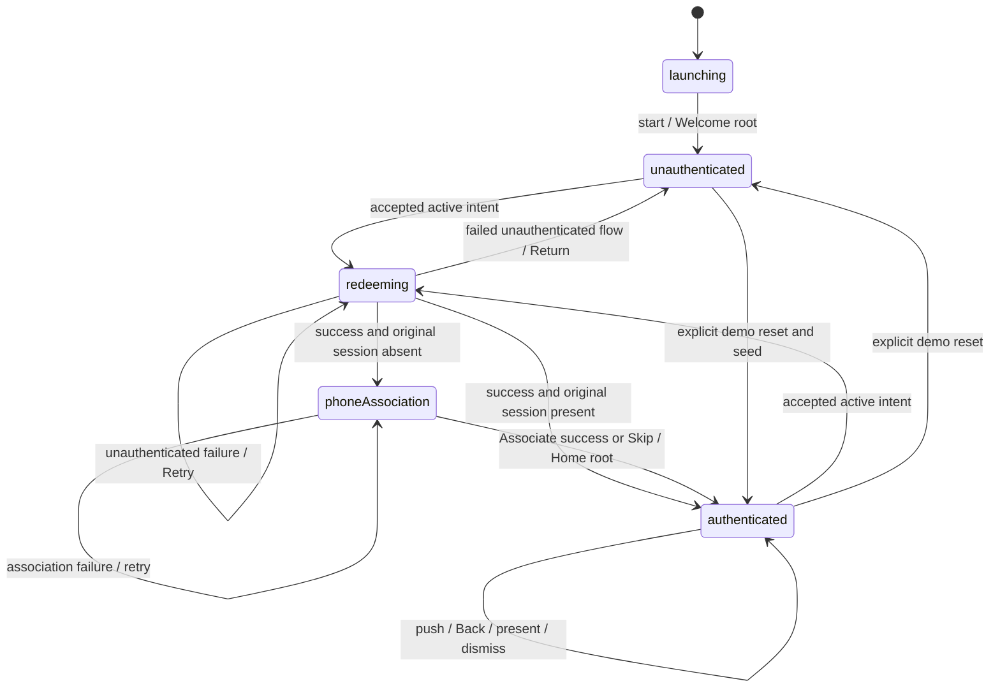

# Navigation, deep-link and lifecycle audit

Analysis-only, 2026-11-07; current working-tree baseline from [architecture-audit.md](architecture-audit.md). F-prefixed references point to that report's detailed findings. Source tracing establishes the stated request sequence; it does not substitute for animated Simulator execution.

## Current state machine



`AppFlow` (`Domain/Models/Models.swift:18`) is deliberately not the entire business state. `phoneAssociation` already has an authenticated SessionStore. `redeeming` can have either session condition. `authenticated` includes Home, secondary, details, pushed XIBs and modals. The actual screen/stack is read from UIKit via router metadata; it cannot safely be inferred from AppFlow alone.

Administrative reset and terminal stop are lifecycle operations outside this enum. Reset can begin in any flow. A synchronous flow assignment can precede completion of an enqueued UIKit transition; diagnostic flow/current-route disagreement during that interval is not automatically invalid state.

## Unauthenticated redeem, traced against code

| Step | Code | Actual behavior |
|---|---|---|
| Accept URL | `App/AppCoordinator.swift:49–59` | All real/custom demo URLs parse into a business intent |
| Own transaction | `Core/DeepLinks/DeepLinks.swift:27–39`; `App/AppCoordinator.swift:66–77` | Processor sets active before callback; app captures original nil session and code |
| Show redeem | `Features/Redeem/RedeemCoordinator.swift:16–19` | Push status hosting controller with blocked Back |
| Resolve account | `Domain/UseCases/RedeemCredentialUseCase.swift:13–22` | Lookup; missing creates deterministic account; both paths login |
| Grant and update client | `:24–28`; `App/AppCoordinator.swift:88–95` | Actor returns credential snapshot; SessionStore applies result; result says onboarding is required |
| Push phone | `App/AppCoordinator.swift:107–122`; `Features/Onboarding/OnboardingCoordinator.swift:22–24` | Redeem coordinator released, its hosting controller remains beneath genuinely pushed phone XIB |
| Associate | `Features/Onboarding/OnboardingCoordinator.swift:26–43` | Loading gate; cancellable async repository call; failure stays; success invokes once-only completion |
| Skip | `:45–46` | Immediate once-only completion when not already loading/finished |
| Finish | `App/AppCoordinator.swift:113–118,124–130` | Release onboarding; install Home root; clear transaction; finish processor and start next waiting intent |

Expected settled stacks: `[welcome]` → `[welcome, redeem]` → `[welcome, redeem, phone]` → `[home]`. There is no modal phone, silent phone root or login-screen navigation to return to. The lower redeem controller remains a valid holding screen, even though its feature coordinator has finished.

On unauthenticated INVALID/EXPIRED/network failure, the active intent remains owned and error UI exposes Retry/Return (`App/AppCoordinator.swift:97–103`, `Features/Redeem/RedeemCoordinator.swift:21,34–37`). Retry reuses `originalSession` (`App/AppCoordinator.swift:68,85`); the actor's possible account history after a partial request does not turn this into an already-authenticated client flow. Return restores Welcome and explicitly finishes the failed intent (`:140–144`).

Skip is disabled while association is running (`Features/Onboarding/AssociatePhoneViewController.swift:38–40`, `Features/Onboarding/OnboardingCoordinator.swift:45`). That is the implemented double-transition policy; it does not make association mandatory because Skip is available before submission and after failure. Do not accidentally turn Skip into a Back/pop path when refactoring.

## Authenticated redeem, traced against code

The starting UserSession is captured when the processor starts this transaction, not when its URL was first queued (`App/AppCoordinator.swift:68`). The use case uses it directly and bypasses account lookup/create/login (`Domain/UseCases/RedeemCredentialUseCase.swift:9–11`). It grants into the existing mock account and returns updated credentials (`Data/Mock/MockBackend.swift:52–69`).

`SessionStore.apply` updates data; `finishAuthenticatedRedeem` makes no root/push/pop request (`App/AppCoordinator.swift:91,132–138`). Existing controller objects and any active modal remain. Home/Secondary/details/sheet observe the same SessionStore, so data-bearing views refresh. A navigation-only XIB does not display credentials; its lack of credential rows is not stale data.

| Before | Intent | After settled success |
|---|---|---|
| `[home]` | ADD-CRED | Same `[home]` controllers, additional grant |
| `[home, secondary]` | ADD-CRED | Same controller identities and stack |
| `[home, lab, details]` | supported authenticated code | Same stack, data updates |
| Any authenticated stack + credential sheet/full-screen lab | supported authenticated code | Same stack/modal, sheet observes updated credentials |

An invisible RedeemCoordinator is still allocated in this path (F05); that is presentation/lifecycle redundancy, not an extra pushed screen. Authenticated failures finish the intent with session intact, but error visibility is incomplete outside Home/Secondary (F16). An immediately started next queued transaction can also replace `demo.status` quickly; define a durable error delivery contract rather than relying on transient diagnostic text.

## Required business rules comparison

| Requirement | Assessment | Evidence / limit |
|---|---|---|
| Create or login while logged out | Satisfied by source and portable tests | Use case `:13–22`; backend `:32–50`; NEW/EXISTING tests |
| Preserve original auth context | Satisfied | AppCoordinator `:68,85,88`; use case `:6–11,27–28` |
| Phone only after flow's authentication | Satisfied | `needsPhoneAssociation` from original session; no phone on authenticated branch |
| Phone optional, genuinely pushed | Satisfied | Onboarding `:22–24,45–46`; lower controller retained in stack |
| No ordinary Back from phone | Satisfied by layered source policy, partly tested | Controller hides item; router/subclass/gesture guards |
| Associate/Skip both make Home root | Satisfied | App completion `:113–129`; UI/coordinator tests exist |
| No re-login/create for authenticated redeem | Satisfied | Use-case early session branch; actor metrics tests |
| No unnecessary authenticated stack reset | Satisfied by source; identity coverage should improve | Auth finish `:132–138`; F10 |
| Visible recoverable errors from any supported screen | Incomplete | F16: several authenticated views have no error surface |
| One active transaction and queued distinct links | Satisfied for current policy | Processor active held through phone/failure; capacity unbounded, F07 |
| Safe terminal lifecycle teardown | Incomplete API edge | F03: queued router command can survive stop |
| Universal Links entry-level support | Conditional, correctly documented | HTTPS parser + browsing activity; no domain/entitlement configured |

## Back and transition enforcement

`PolicyNavigationController` intercepts direct UIKit pop, popTo and popToRoot (`Core/Navigation/NavigationRouter.swift:29–42`). Router ordinary pop/popTo reject blocked current policy before queuing and again at execution (`:74–75,97–104`). Protected controllers hide the bar item; gesture recognizer is enabled/disabled from current top policy and stack count (`:130–135`) and has its own should-begin guard (`:166–168`).

On leaving a protected route through explicit stack replacement, new Home is allowed; ordinary subsequent pushes regain bar/gesture Back. Keeping the original UIKit gesture delegate is purposeful. Explicit replacement is coordinator authority to finish/reset, not an ordinary Back request; policy must not block it.

Commands are serialized with `transitioning` and a FIFO queue. UIKit `willShow`/`didShow` track both programmatic and user-initiated transitions; metadata is pruned against the actual resulting stack. `didShow` schedules draining after its delegate callback (`:138–148`). An interactive pop that cancels must leave metadata for the actual top controller; deterministic coverage is missing, F01.

The duplicate-route rule checks the whole stack at execution, so a destination already below top is ignored rather than popped-to (`:91–92`). That is explicit demo policy, not a duplicate identity bug. Do not change it to pop-to implicitly without deciding what that means for protected routes and history.

## Modal dimension

HomeCoordinator creates a hosting-controller page sheet with medium/large detents (`Features/Home/HomeCoordinator.swift:37–46`) and a full-screen lab XIB (`:48–60`). XIB actions can dismiss then enqueue push or a different presentation. No new UINavigationController or SwiftUI NavigationStack is created.

The router tracks `presentedRoute` separately, uses UIKit presentation/dismissal completion, handles adaptive interactive dismissal/cancellation, rejects detached presentation and ignores an extra presentation while one is visible (`Core/Navigation/NavigationRouter.swift:109–125,150–164`). Root/stack replacement clears obsolete queued commands and queues dismissal before replacement (`:76–80`). A single gate covers these transition types; this is coherent for the demo but needs attached-window tests before simplification.

The user's earlier five UI failures prove an accessibility lookup defect, not failed presentation: the actual result hierarchy shows visible Done/title/stack elements with the same outer identifier. The local baseline removes that identifier and keeps leaf identifiers (`Features/Home/HomeCoordinator.swift:122–143`). A new real-UI regression checks them (`CoordinatorNavigationDemoUITests/NavigationUITests.swift:98–113`). That fix predates this audit; it was not made by the audit and has no recorded post-fix Simulator pass.

## Complete URL lifecycle and concurrency policy

```mermaid
sequenceDiagram
    participant OS as Scene / demo URL
    participant P as Parser
    participant Q as Intent processor
    participant A as AppCoordinator
    participant U as Use case / actor
    participant N as Router / nav
    OS->>P: URL
    P->>Q: validated redeem intent
    Q->>A: set active, dispatch
    A->>A: snapshot original session
    A->>U: execute once
    OS->>P: another URL
    P->>Q: distinct intent waits; duplicate suppressed
    U-->>A: result
    alt originally unauthenticated
        A->>N: push protected phone
        Note over Q,A: active remains owned through retry / phone
        N-->>A: Associate success / Skip outcome
        A->>N: replace with Home
    else originally authenticated
        A->>A: update session data without stack change
    end
    A->>Q: finish active
    Q->>A: next intent; capture session now
```

Cold connection URLs/browsing activities (`App/AppDelegate.swift:22–24`), warm URL contexts (`:43–44`) and browsing continuation (`:46–49`) feed the same `receive` method. Background URL activation uses that scene delivery path; no separate scene-activation handler performs redemption. Simultaneous scene batches arrive as unordered Sets; FIFO means **processor submission order**, not an invented chronological ordering of the OS Set.

Parser uses URLComponents and rejects unsupported routes/hosts, userinfo, port, fragment, missing/duplicate/empty code, disallowed syntax or length. Backend validates supported code meaning separately. Unknown uppercase codes are not a parser error; they are recoverable backend errors. No navigation destination is encoded into AppIntent.

Active/pending duplicate suppression is local to the current queue. Re-delivery after completion is allowed and backend grants are idempotent for the same account/code. New links during phone wait until Associate/Skip, then start against the now-authenticated session. New links during a recoverable unauthenticated error wait until retry succeeds/phone completes or Return explicitly ends the flow. During reset, raw URLs defer until the environment is restored; this should be bounded and preferably validated, F07.

## Cancellation, invalid transitions and ownership

- Reset invalidates generation first, cancels/join redemption, stops children, clears intent state, resets the actor, restores/clears session and installs the chosen root (`App/AppCoordinator.swift:149–179`). Guards follow every await. Administrative caller cancellation deliberately does not leave a half-reset environment.
- Redeem results check cancellation/generation before use; phone results check cancellation/finished and report through a generation-checked app completion. Existing handlers are protected against duplicate Associate/Skip and obsolete UI callbacks.
- Reset cancels phone but does not await it. With current cancellation-aware actor commits no stale phone effect was shown. A noncooperative real backend requires explicit effect/cancellation semantics; generation checks only suppress UI application, not remote server effects.
- **Invalid terminal transition F03:** stop while phone push is queued → release coordinator → didShow drains phone. Pending router work needs explicit shutdown invalidation, distinct from ordinary reset/root replacement.
- **Invalid recovery surface F16:** authenticated details/lab/modal + redeem error → finished intent with no visible error on that screen. Navigation/session remain valid, but recovery feedback is missing.
- AppCoordinator is effectively one-shot: `started` stays true after stop. Clarify that contract rather than silently adding restart behavior in a cleanup refactor.

No retain cycle was found in injected callbacks; parent/feature UI closures use weak captures. Main-actor observable/navigation ownership is consistent, and backend mutable state is actor-isolated. The missing evidence is staged lifecycle/interactive execution and deallocation testing, not a proven leaked coordinator.

## Prioritized navigation recommendations

1. Add real transition/cancellation evidence and OS delivery smoke tests (F01/F02/F09).
2. Specify visible authenticated error recovery and terminal-stop semantics; address F16/F03 narrowly.
3. Bound incoming intent retention without losing active-flow ownership (F07).
4. Simplify child ownership and invisible presentation state only after those tests protect it (F04/F05/F06).
5. Improve compact phone layout separately (F13), preserving its Back policy and XIB.

See [improvement-plan.md](improvement-plan.md) for implementation acceptance criteria. No navigation change was performed during this audit.
